# Xylem

[Website](https://andrelnfernandes.github.io/xylem/) · [Leia em português](README.pt-BR.md)

See your whole disk as one tree, gather files from any folder, and act on all of
them at once, from any terminal, right from the keyboard.

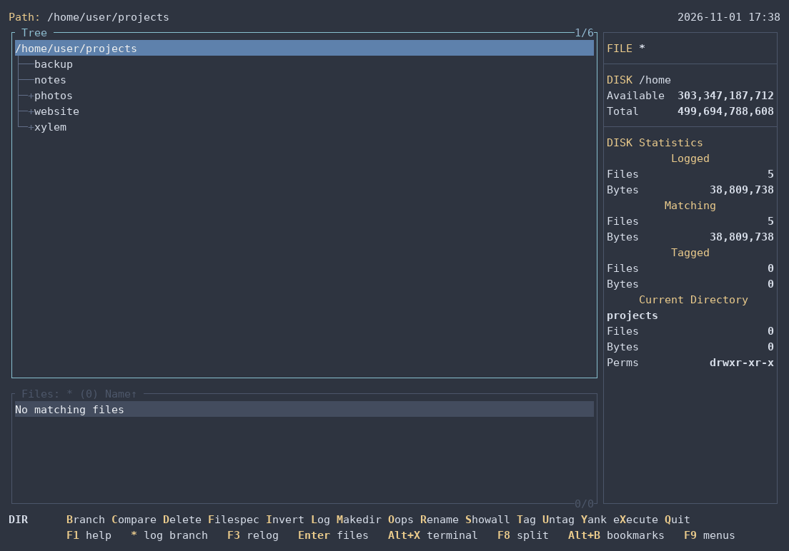

- **Open almost anything right there:** SQLite with full `JOIN` queries,
  spreadsheets, CSV, Parquet, JSON, Markdown, logs and archives.
- **Turn data into files:** one table becomes a page, a SQL script or a database,
  with a preview before anything is written.
- **Free up space:** see what takes room, and find duplicate files and folders,
  even on Google Drive without downloading them.
- **Reach beyond your disk:** work on servers over SSH and in containers as on
  your own disk, and with Google Drive, S3 and other clouds through rclone.
- **Stay in one place:** a built-in terminal whose tree follows your `cd`, and Git
  status right in the file list.
- **Open files you don't trust:** nothing in them runs, and everything has a limit.
- **Make it yours:** twelve themes, configurable keys, and help in six languages.

## Try it

```bash
cargo install xylem-fm
xy
```

That needs Rust and a C compiler. Without them, Linux (x86_64 and ARM64) has static
binaries, `.deb` and `.rpm` on the
[Releases](https://github.com/andrelnfernandes/xylem/releases) page, and there is an
experimental Windows build. [Installation](#installation) has the details.

## Screenshots

The directory tree, the file window and the statistics:

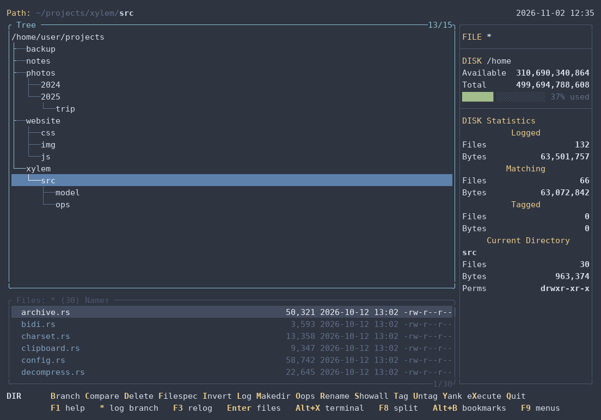

**Branch** (`B`) lists the files of a whole branch; tagged files (`T`) are
highlighted and counted on the right:

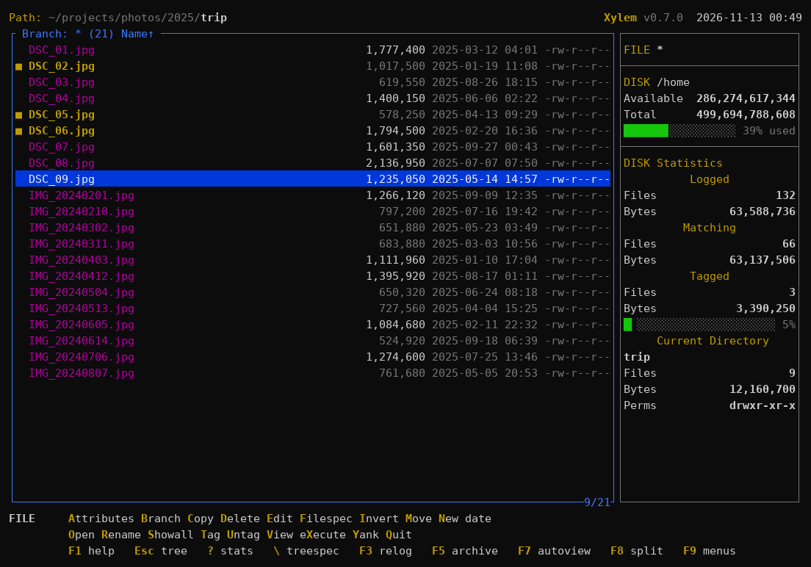

**Split window** (F8), each side with its own directory:

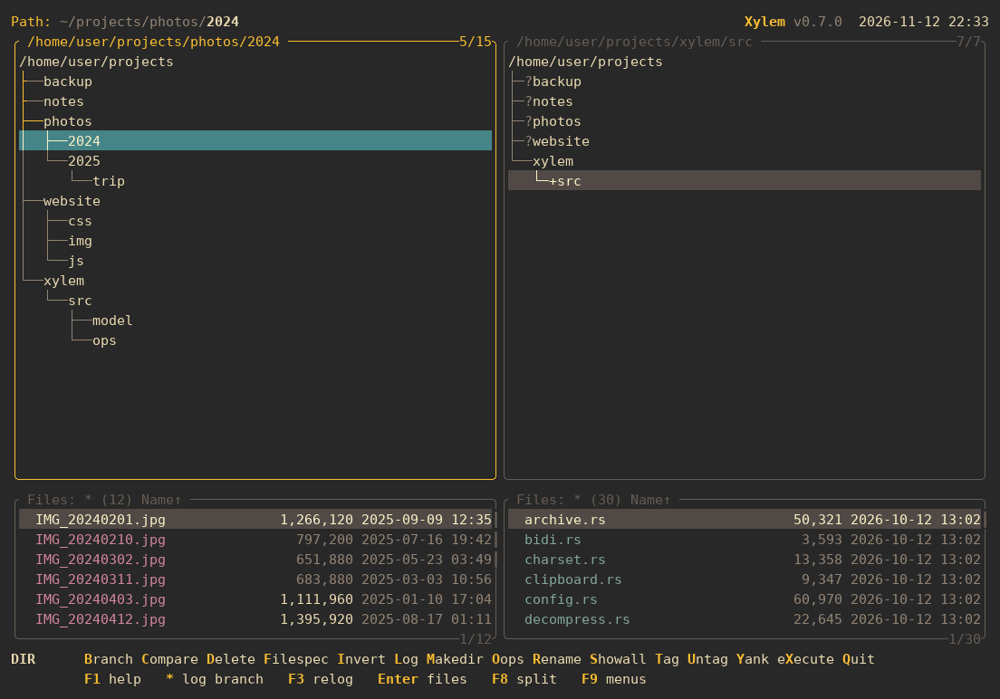

**A SQLite database** in the viewer: the list of tables, a filter, a query with a
`JOIN`, and a `DELETE` refused, since Xylem only reads:

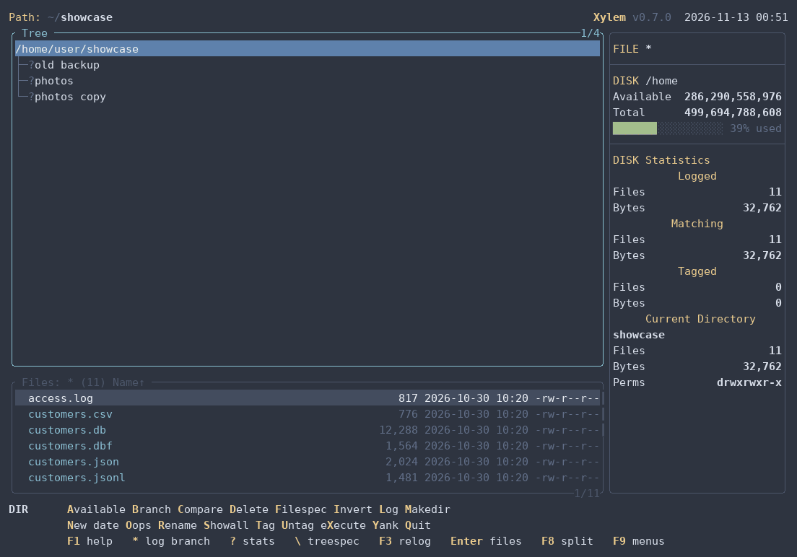

**Batch** (Ctrl+B): a table becomes a page, a SQL script and a database, each with a
preview, and each value escaped for that kind of file:

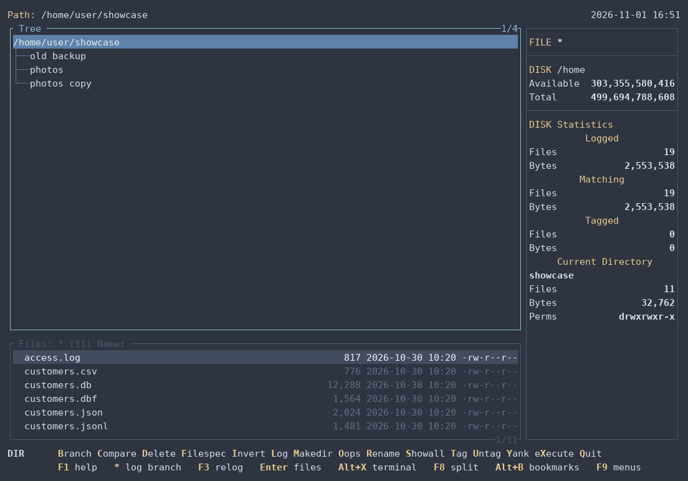

**Viewer** (`V`), with syntax colors:

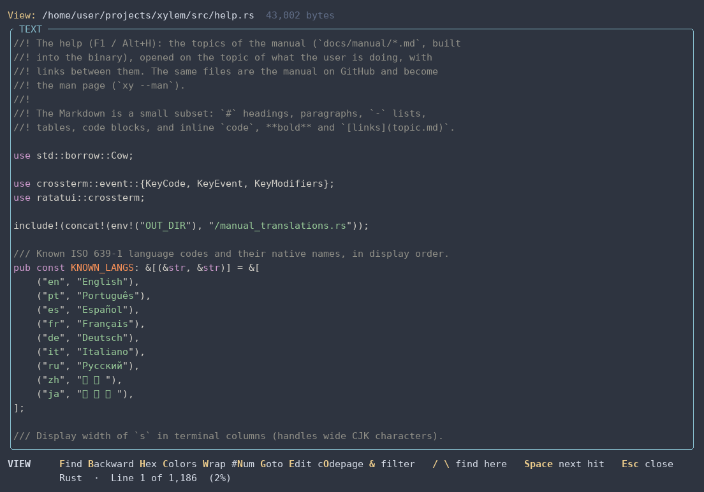

**Built-in terminal** (Alt+X): a `cd` in the shell takes the tree along, and
Alt+O types the tagged files at the prompt:

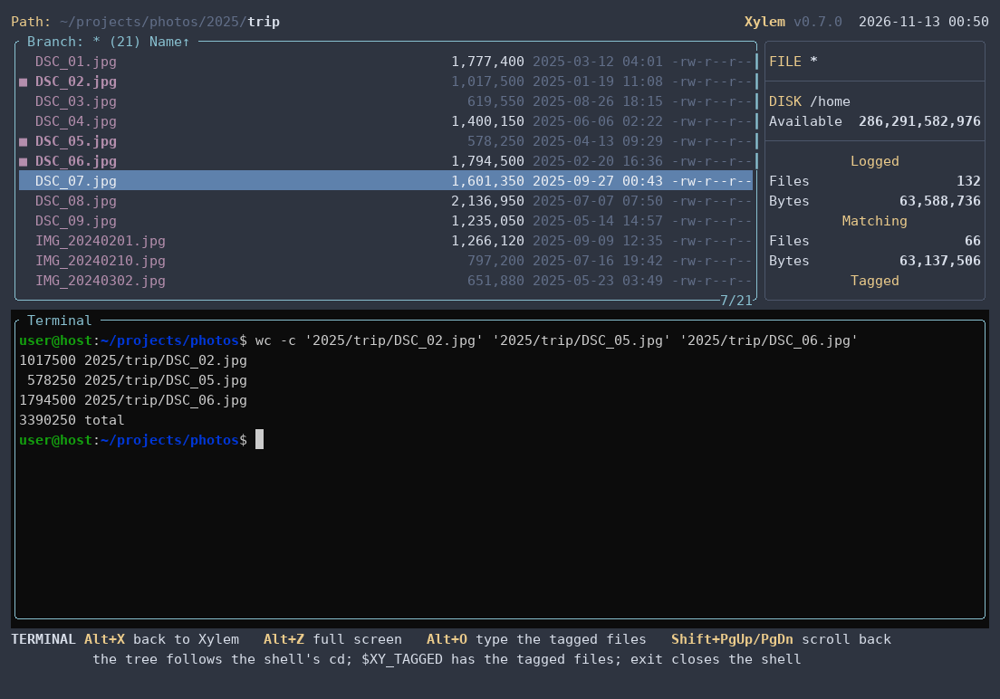

**Git** (optional): status letters in the file list and the Git menu (Ctrl+G):

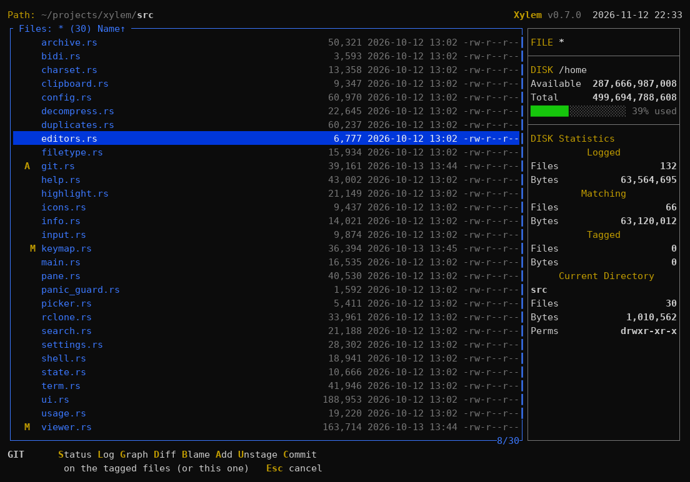

**Usage** (Alt+W): where the space goes, folders and files together by the
space they take:

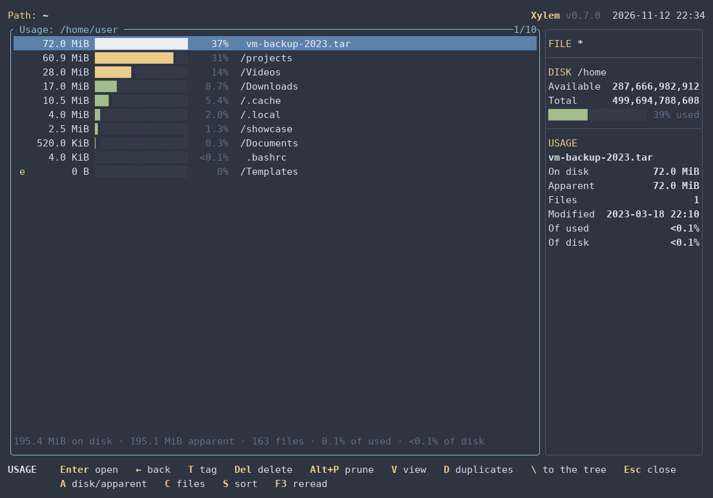

**Themes**: besides the classic blue, `dark`, `light`, `mono`, `norton`,
`solarized`, `gruvbox` (below), `nord`, and three that look at home on today's
desktops: `slate` (in the style of Windows Terminal), `graphite` and `daylight`
(macOS in dark and light mode), and `vivid`, with strong colors for
presentations:

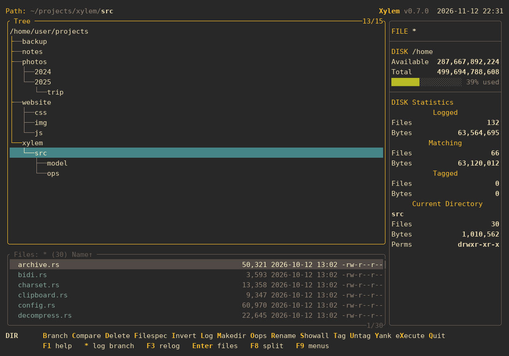

## What it does

- **One tree, many files:** a directory tree logged into memory, the file window
  below it, Branch and Showall to list the files of a whole branch or of
  everything logged, tags that group operations act on, and ZTreeWin's keys.
- **File operations:** copy and move (with or without the paths, with progress
  and conflict details), delete to the trash with Oops to restore, Prune,
  rename with masks, permissions and dates, Compare between two windows.
- **Finding things:** Filespec by name, date and size, Treespec to type a path,
  bookmarks, and Ctrl+S to search the tagged files for text.
- **Looking inside:** a text and hex viewer with search, a line filter with
  regular expressions and syntax colors, Markdown shown rendered, a table mode with a SQL filter for
  spreadsheets, CSV, JSON Lines, DBF, SQLite and Parquet, and Ctrl+B to turn
  those records or lines into a script, JSON, SQL or anything else,
  Autoview next to the list, ZIP, 7z and TAR archives opened as directories,
  and display modes that show owners or what each file is.
- **Duplicates:** Alt+Y finds files and whole folders with the same contents,
  without downloading anything from a folder mounted by rclone, and always
  leaves one copy.
- **Where the space goes:** the Usage view (Alt+W) lists a branch's folders
  and files by the space they take, largest first, down to what fills the
  disk; Alt+K Percent shows each folder's share right in the tree.
- **Beyond XTree:** a built-in terminal whose tree follows the shell, remote
  machines over SSH and containers through `docker exec` (copy, move, rename,
  delete, permissions and dates there, with their own terminal), Google Drive,
  S3 and other cloud storage through rclone, network shares read in the
  background, bookmarks with names, an optional Git menu, the clipboard, a
  configuration screen and themes.

## Usage

```bash
xy [directory]
```

With no argument, it opens the current directory. `xy --help` shows the
options. To have the shell end up in the directory you were in when you quit
with Alt+Q, add the small shell function from
[Quitting and changing the shell's directory](docs/manual/quit.md).

## Installation

**Ready-made binary:** download the archive for your system from the
[Releases](https://github.com/andrelnfernandes/xylem/releases) page: Linux
x86_64 or ARM64 (static, runs on any distribution) or Windows x86_64.
Extract it and put `xy` (`xy.exe`) somewhere on your `PATH`, e.g.:

```bash
tar xzf xy-v0.7.0-x86_64-unknown-linux-musl.tar.gz
install -m 755 xy-v0.7.0-x86_64-unknown-linux-musl/xy ~/.local/bin/
```

Each archive has a `.sha256` next to it, to check with `sha256sum -c`.

**Package (.deb or .rpm):** the releases from 0.5.0 on also have packages for
Debian, Ubuntu and their derivatives (`.deb`) and for Fedora, RHEL, openSUSE
and theirs (`.rpm`), for x86_64 and ARM64 (`arm64`/`aarch64` in the name).
Besides `xy`, they install the menu entry, the icons and the man page:

```bash
sudo apt install ./xylem-fm_*_amd64.deb     # Debian, Ubuntu
sudo dnf install ./xylem-fm-*.x86_64.rpm    # Fedora, RHEL (zypper on openSUSE)
```

The package is called `xylem-fm`, as on crates.io. It comes from the
Releases page, not from a repository, so it is not updated by itself: install
the next one the same way. To remove it, `sudo apt remove xylem-fm` or
`sudo dnf remove xylem-fm`.

**With Cargo** (needs Rust, via [rustup](https://rustup.rs), and a C compiler,
for SQLite and zstd), from
[crates.io](https://crates.io/crates/xylem-fm), where Xylem is called
`xylem-fm` (the name `xylem` was taken); the command is `xy`:

```bash
cargo install xylem-fm
```

Or the latest code, straight from GitHub, or from a clone of the
repository (in the project folder):

```bash
cargo install --git https://github.com/andrelnfernandes/xylem
cargo install --path .
```

The binary goes to `~/.cargo/bin/xy` (which rustup already puts on your `PATH`).
To update, run the same command again; to remove it, `cargo uninstall xylem-fm`.

**Menu entry (Linux, optional; the packages already have it):** to have
Xylem in your desktop's application menu, opening in a terminal, run this in
a clone of the repository. `xy` must be on the `PATH` your desktop sees
(`~/.local/bin` usually is; `~/.cargo/bin` not always).

```bash
for s in 16 32 48 64 128 256 512; do
    install -Dm644 docs/icons/xylem-$s.png ~/.local/share/icons/hicolor/${s}x$s/apps/xylem.png
done
install -Dm644 docs/icons/xylem.svg ~/.local/share/icons/hicolor/scalable/apps/xylem.svg
install -Dm644 packaging/linux/xylem.desktop ~/.local/share/applications/xylem.desktop
```

**Man page (optional; the packages already have it):** in a terminal,
`xy --man` shows it; redirected, it prints the source to install (the
release archives for Linux also include it as `xy.1`):

```bash
mkdir -p ~/.local/share/man/man1 && xy --man > ~/.local/share/man/man1/xy.1
```

## Documentation

**F1** (or **Alt+H**, in terminals that keep F1 for themselves, like GNOME
Terminal) opens help about what you are doing: inside a prompt, the help for
that prompt; in a window, the help for that window, with links to the rest.

The same help is [the manual](docs/manual/index.md), readable here on GitHub,
and the man page (`xy --man`). Some topics:
[the tree window](docs/manual/tree.md), [the file window](docs/manual/files.md),
[tags and group operations](docs/manual/tagging.md),
[Copy and Move](docs/manual/copy-move.md), [Filespec](docs/manual/filespec.md),
[the built-in terminal](docs/manual/terminal.md),
[cloud storage (rclone)](docs/manual/cloud.md), [Git](docs/manual/git.md),
[configuration](docs/manual/configuration.md),
[Windows](docs/manual/windows.md) (experimental) and the
[comparison with ZTreeWin](docs/manual/ztreewin.md).

The help also comes in Portuguese, Spanish, French, German and Chinese. The
Spanish, French, German and Chinese translations have not been reviewed by
native speakers: if you read one of these languages, [suggestions are welcome](docs/manual/TRANSLATING.md#reviews-wanted).

## Security: hostile files

Xylem should never crash, hang, run code, write outside the destination or
exhaust memory because of what a file contains or how it is named, even when
the file was crafted to do so. Files you download, archives you open, names a
remote server sends and repositories you clone are all treated as hostile. Any
such malfunction is a serious bug, and it will be fixed promptly once reported.

Nevertheless, bugs happen. Here is what Xylem does to keep the risk small:

- Everything Xylem reads on its own (text, hex, encodings, compressed files,
  archives, Markdown, spreadsheets, CSV, JSON Lines, DBF) goes through
  memory-safe Rust parsers. The
  exception is SQLite databases and Parquet files, read by libraries in C:
  they run only when you open such a file with V, never in Autoview. No
  external program runs on a file unless you ask for it with E, O or X.
- Everything has a limit: how much is read, how much is decompressed, how long
  it takes and how much memory a decompressor may use. Only one level of
  compression is undone, and nothing is written to disk to show a file.
- Control characters and bidirectional controls (Trojan Source) never reach
  the terminal. Names with hidden bidi characters are marked, and O asks
  before opening them.
- When extracting archives or copying from a remote machine, paths with `..` or
  absolute paths are refused, symbolic links in archives are not extracted,
  setuid bits are dropped and names sent by an SFTP server are checked.
- Looking at a Git repository runs nothing it names: no hooks, `core.fsmonitor`,
  external diffs or text conversions, unless its folder is under `git_trusted`.
  One with filters of its own gets no markers, Status, Diff or Blame there.
- The dependencies are checked against the RustSec database in CI.

You can make the attack surface smaller still:

- Turn off decompression in the viewer (`viewer_decompress = false`, F12)
  if you browse untrusted folders with Autoview, or keep Autoview (F7) closed
  there.
- Leave Git integration off (`git = false`, the default) for repositories you
  did not create.
- Do not run Xylem as root.
- Open untrusted files with O only when you trust the program that will open
  them: Xylem hands the file over to it.

Found a problem? Please report it privately [via GitHub Security Advisories](https://github.com/andrelnfernandes/xylem/security/advisories/new), not in a public issue.

## Roadmap

### Done

- The XTree core (phases 0 to 4): the classic screen, the tree and the file
  window, Filespec, Showall and Branch, tags and group operations, the split
  window, Compare, archives, Edit and eXecute, configuration, themes,
  configurable keys, the help and persistent history.
- Beyond it: the built-in terminal, remote machines over SSH and containers
  (browsing, writing there, their terminal), cloud storage through rclone, with
  a large Drive opening at once, Git, the Usage view and its actions, bookmarks
  with names, Oops, binary files in a hex editor of your choice,
  Nerd Fonts icons, the help in six languages and an experimental Windows
  build.
- The viewer: encodings found by itself, compressed files, a configurable
  size limit, soft wrap, line numbers, goto line, a line filter, protection
  against hidden text direction characters, and a [table mode](docs/manual/viewer.md)
  with a SQL filter, and whole queries on SQLite, for spreadsheets (XLSX, ODS),
  CSV, JSON Lines, DBF with its memo files, SQLite and Parquet, and rendered
  Markdown.
- Batch (Ctrl+B) over tagged files, the records of a table or the lines of a
  text, with templates, conditions, totals and output to SQLite.
- Duplicates (Alt+Y): files and whole folders, on local disks and through the
  hashes rclone gives.

### Next

- **Remote machines (SSH):** Edit and Open (through a temporary copy that goes
  back when saved), eXecute and Git over ssh, and periodic refresh.
- **Viewer:** a viewer that reads in windows, like `less`, with no size limit
  for uncompressed files, and logs (follow, jump to the end, colors by level).
- **From ZTreeWin:** comparing the contents of two files (JFC), and saving the
  log to open a disk's tree at once next time.
- **Hardening:** the leftovers of the security pass, listed in
  [BACKLOG.md](BACKLOG.md).

### For later

- Windows: it builds and passes the tests (see
  [Windows](docs/manual/windows.md)), but it is not a priority while
  ZTreeWin exists. Maybe macOS.
- Postponed by choice: macros, chown and Graft.

The full list of what is left, including the developers' notes, is in
[BACKLOG.md](BACKLOG.md), and the order of the work is in
[the roadmap](docs/plans/roadmap.md) (in Portuguese).

## Structure

- `src/model/` — in-memory directory tree (arena), independent of the UI
- `src/app/` — global state (prompts, operations) and command execution
- `src/pane.rs` — one window: tree, file list, cursors and filespec
- `src/input.rs` — commands and the prompts' text field
- `src/keymap.rs` — default keys and configuration overrides
- `src/help.rs` — the help (F1): topics, links, and the man page
- `docs/manual/` — the manual: the help's topics, in Markdown
- [`demo/`](demo/README.md) — files in every format and Batch templates to try
- `src/filetype.rs` — what a file is, for the Type display mode
- `src/ui.rs` — screen drawing (ratatui)
- `src/viewer.rs` — text/hex viewer
- `src/viewer/` — table mode, rendered Markdown, line filter, SQL filter and Batch over records
- `src/usage.rs` — the Usage view
- `src/duplicates.rs` — finding duplicates
- `src/search.rs` — text search, in tagged files and in the viewer
- `src/decompress.rs` — compressed files, with limits
- `src/charset.rs` — text encodings
- `src/bidi.rs` — the guard against hidden text direction characters
- `src/archive.rs` — ZIP, 7z and TAR reading; ZIP and TAR creation
- `src/watch.rs` — notifications of changes on disk (inotify)
- `src/shell.rs` — editor and shell commands (with safe quoting)
- `src/editors.rs` — which editor E uses for each file (`[editors]`)
- `src/term.rs` — built-in terminal (pseudo-terminal, key codes, colors)
- `src/git.rs` — Git menu (Ctrl+G) and status markers, through the `git` program
- `src/rclone.rs` — folders mounted by rclone: which service, and its listings and hashes
- `src/remote/` — remote machines: SFTP over the system's `ssh`
- `src/config.rs` — configuration file, themes and formats
- `src/settings.rs` — configuration screen (F12)
- `src/state.rs` — prompt history between runs
- `src/model/compare.rs` — Compare rules
- `src/model/filespec.rs` — file filter
- `src/ops/` — copy, move and delete, in steps (progress, conflicts, cancellation)
- `docs/screenshots/tools/` — regenerates the README screenshots (`run.sh`, Linux)
- `tests/e2e.rs` — end-to-end tests: the real `xy` in a pseudo-terminal, driven by keys (Linux); `cargo test` also runs property tests (proptest) on the Filespec and the rename masks
- `docs/icons/` — the icon, in SVG, PNG (16 to 512) and ICO
- `build.rs` — embeds the icon in `xy.exe` (Windows)
- `packaging/linux/` — menu entry (`xylem.desktop`) and the `.deb` and `.rpm` packages (`packages.sh`)
- `site/` — the website

## About

Xylem's keys and way of working follow XTree and ZTreeWin whenever possible; the
differences are in [Comparison with ZTreeWin](docs/manual/ztreewin.md).

It was called **xt** until version 0.1; on its first run, it moves xt's
configuration, history and bookmarks to its own folders. The name: the xylem is the
tissue that carries water through a tree.

## Disclaimer

Xylem is an independent project, written from scratch. It is not affiliated
with, endorsed by or connected to Zedtek, Inc. (ZTreeWin) or to the owners of
XTree. It contains no code from those programs; their names are mentioned only
to describe what inspired Xylem and how it compares. XTree, ZTree and ZTreeWin
are trademarks of their respective owners.

## License

Xylem is released under the [MIT License](LICENSE).
