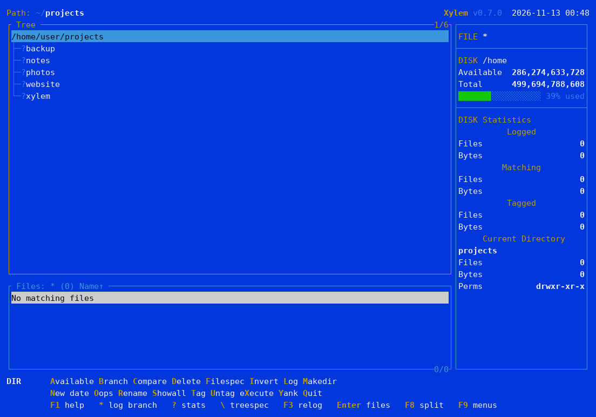
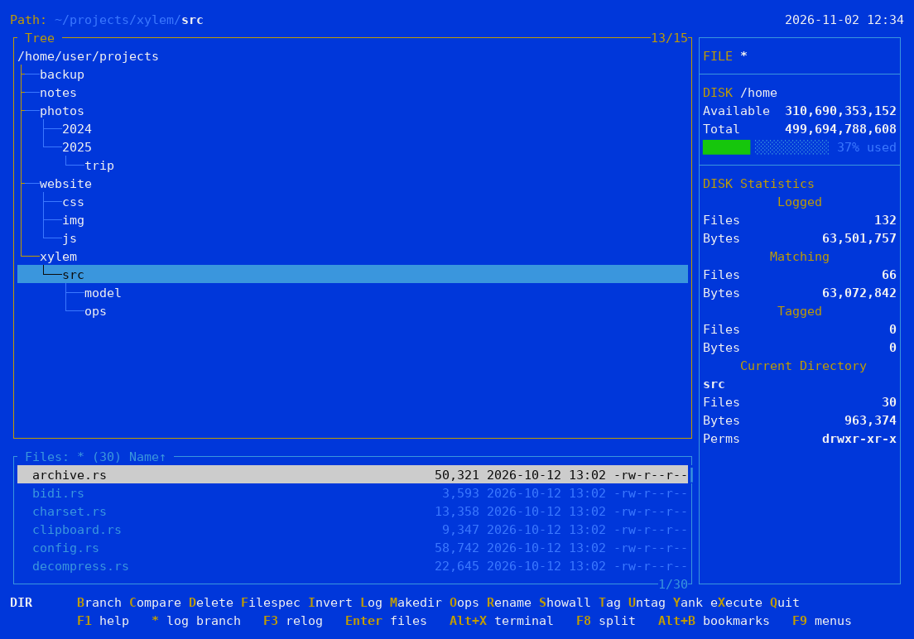
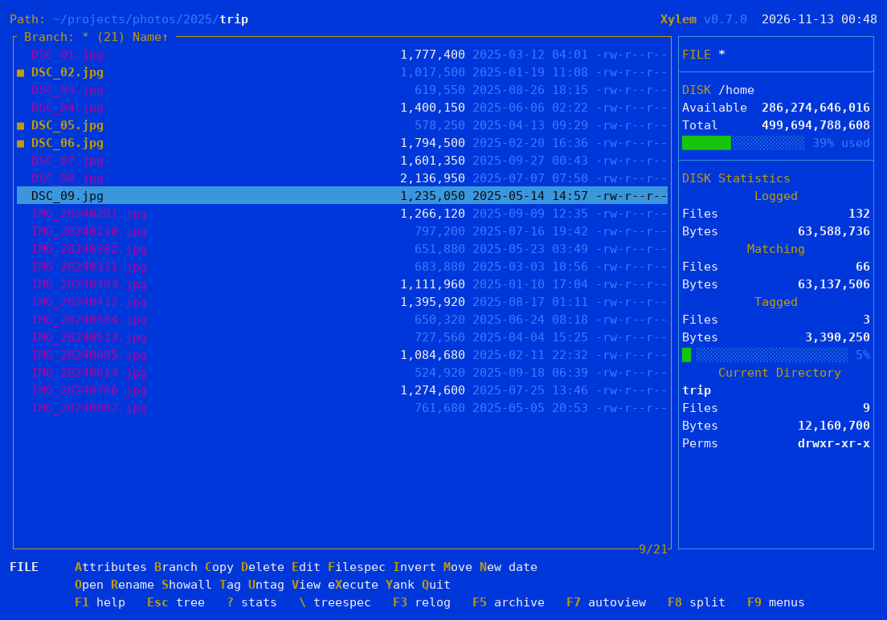
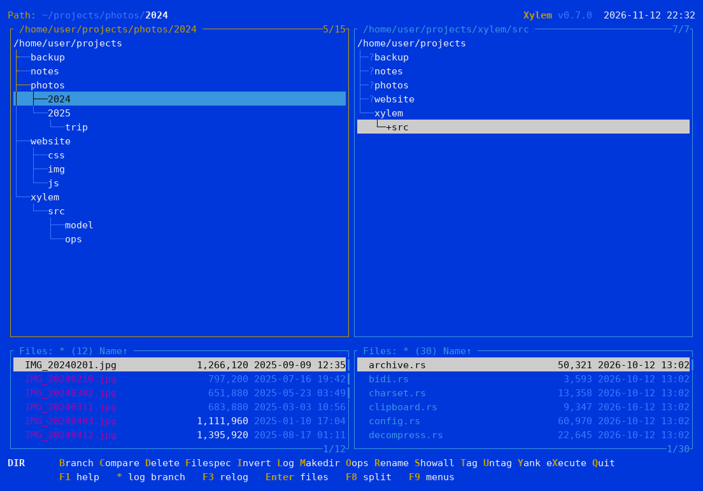
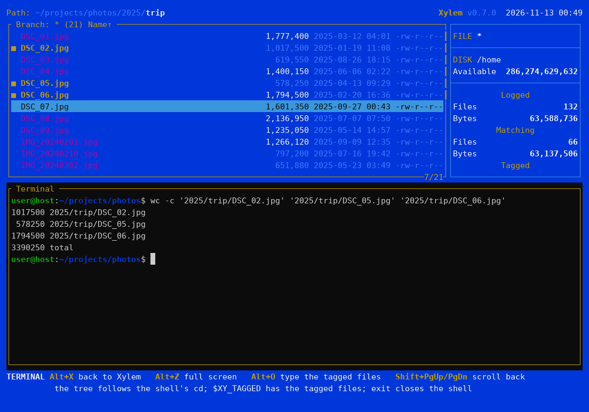
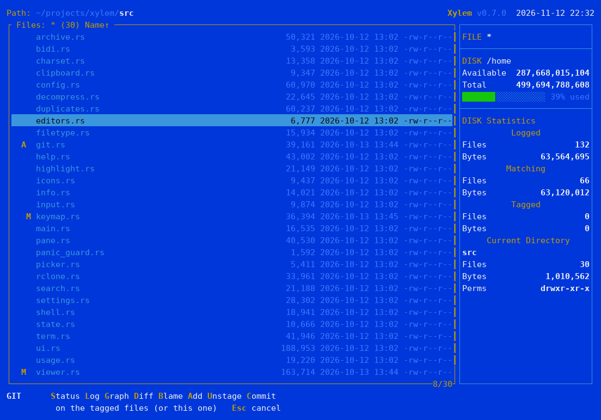
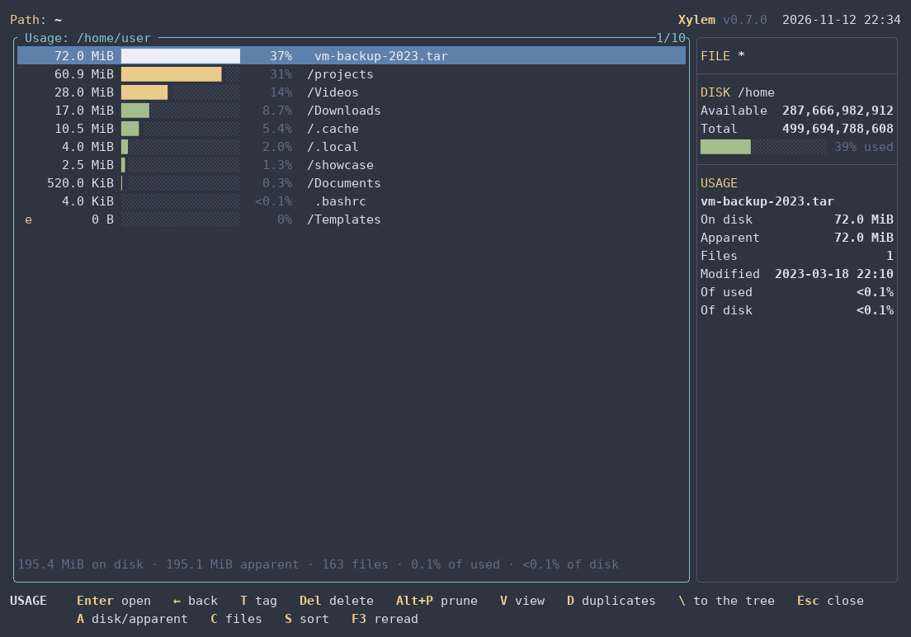
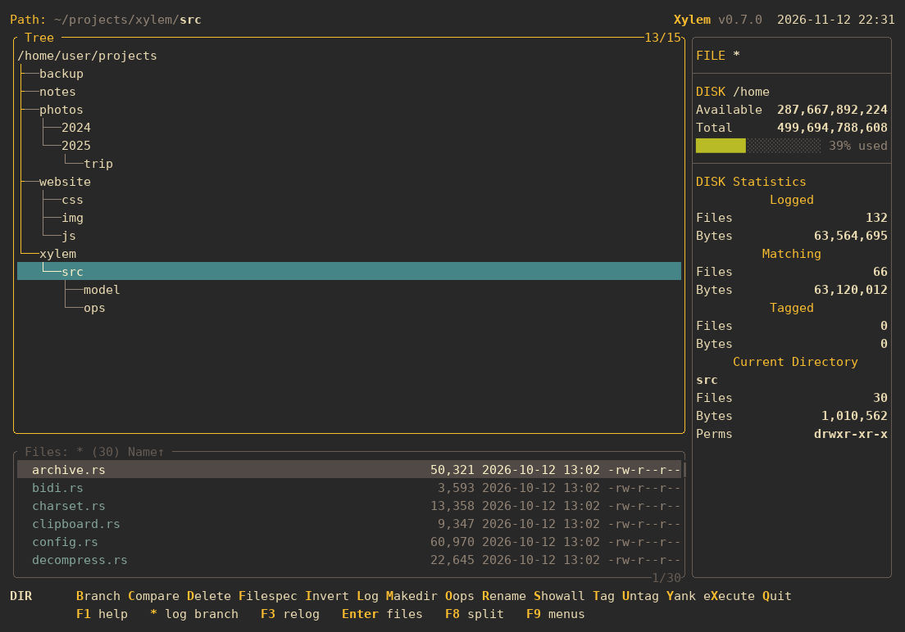

# Xylem

[Read in English](README.md)

Gerenciador de arquivos em modo texto para Linux, inspirado no XTree e no ZTreeWin.

O Xylem se chamava **xt** até a versão 0.1; o comando agora é `xy`. Na
primeira execução, ele move a configuração, o histórico e os bookmarks do xt
para as pastas novas. O nome: o xilema (*xylem*, em inglês) é o tecido que
leva a água pela árvore, e começa com X, como o XTree.



## Por que o Xylem?

Uso alguma variação do XTree desde a década de 1990, e o ZTreeWin continua
sendo, para mim, o melhor gerenciador de arquivos em modo texto. Desenvolvi o
Xylem por sentir falta de algo tão bom quanto ele rodando no Linux: as versões
que existem parecem abandonadas ou se afastaram demais do visual e do jeito
clássicos.

O Xylem também compila para Windows, porque o Rust torna isso fácil, mas uma
versão para Windows não é prioridade: no Windows existe o ZTreeWin.

O Xylem segue as teclas e o jeito de trabalhar do ZTreeWin sempre que possível;
as diferenças estão descritas em [Comparação com o ZTreeWin](docs/manual/pt/ztreewin.md).

## Segurança: arquivos hostis

O Xylem nunca deve travar, congelar, executar código, escrever fora do destino
ou esgotar a memória devido ao conteúdo ou ao nome de um arquivo, mesmo que ele
tenha sido criado propositalmente para isso. Arquivos baixados, pacotes abertos,
nomes enviados por um servidor remoto e repositórios clonados são todos tratados
como hostis. Qualquer falha desse tipo é um erro grave e será corrigida com
rapidez assim que relatada.

Ainda assim, erros acontecem. Veja o que o Xylem faz para manter o risco baixo:

- Tudo o que o Xylem lê por conta própria (texto, hex, codificações, arquivos
  comprimidos, pacotes, Markdown, planilhas, CSV, JSON Lines, DBF) passa por analisadores em Rust com
  segurança de memória. A exceção são bancos SQLite e arquivos Parquet, lidos
  por bibliotecas em C: elas só rodam quando você abre esse arquivo com V, nunca
  no Autoview. Nenhum programa externo é executado em um arquivo a menos que
  você solicite com E, O ou X.
- Tudo tem limite: a quantidade lida, a quantidade descomprimida, o tempo gasto
  e o volume de memória que um descompressor pode usar. Apenas um nível de
  compressão é desfeito, e nada é gravado em disco para exibir um arquivo.
- Caracteres de controle e controles bidirecionais (Trojan Source) nunca chegam
  ao terminal. Nomes com caracteres bidi ocultos são sinalizados, e o O pede
  confirmação antes de abri-los.
- Ao extrair pacotes ou copiar de uma máquina remota, caminhos com `..` ou
  caminhos absolutos são recusados, links simbólicos dentro de pacotes não são
  extraídos, bits setuid são descartados e nomes enviados por servidores SFTP são
  verificados.
- Olhar um repositório Git não executa nada que ele nomeie: nem ganchos,
  `core.fsmonitor`, diffs externos ou conversões de texto, a não ser que a pasta
  dele esteja em `git_trusted`. Um repositório com filtros próprios fica sem
  marcadores, Status, Diff e Blame.
- As dependências são verificadas contra o banco de dados do RustSec no CI.

Você pode reduzir ainda mais a superfície de ataque:

- Desative a descompressão no visualizador (`viewer_decompress = false`, F12)
  ao navegar em pastas não confiáveis com o Autoview, ou mantenha o Autoview (F7)
  fechado nelas.
- Mantenha a integração com o Git desativada (`git = false`, o padrão) para
  repositórios que você não criou.
- Não execute o Xylem como root.
- Só abra arquivos não confiáveis com O se você confiar no programa que irá
  abri-los: o Xylem apenas repassa o arquivo para ele.

Encontrou um problema? Relate-o de forma privada [pelos avisos de segurança do GitHub](https://github.com/andrelnfernandes/xylem/security/advisories/new), não em uma issue pública.

## Aviso

O Xylem é um projeto independente, escrito do zero. Não tem ligação com a
Zedtek, Inc. (ZTreeWin) nem com os donos do XTree, nem é endossado por eles.
Não contém código desses programas; os nomes deles aparecem só para descrever
o que inspirou o Xylem e como ele se compara. XTree, ZTree e ZTreeWin são marcas
de seus respectivos donos.

## Telas

A árvore de diretórios, a janela de arquivos e as estatísticas, no tema clássico:



**Branch** (`B`) lista os arquivos de um ramo inteiro; os arquivos marcados
(`T`) ficam destacados e são contados à direita:



**Janela dividida** (F8), cada lado com seu próprio diretório:



**Visualizador** (`V`), com cores de sintaxe:


**Terminal embutido** (Alt+X): um `cd` no shell leva a árvore junto, e o
Alt+O digita os arquivos marcados no prompt:



**Git** (opcional): as letras de status na lista de arquivos e o menu Git
(Ctrl+G):



**Usage** (Alt+W): para onde vai o espaço, pastas e arquivos juntos pelo
espaço que ocupam (aqui no tema nord):



**Temas**: além do azul clássico, `dark`, `light`, `mono`, `norton`,
`solarized`, `gruvbox` (abaixo), `nord` e três que combinam com os desktops de
hoje: `slate` (no estilo do Windows Terminal), `graphite` e `daylight` (macOS
nos modos escuro e claro), além do `vivid`, com cores fortes para
apresentações:



## Instalação

**Binário pronto:** baixe o arquivo do seu sistema na página de
[Releases](https://github.com/andrelnfernandes/xylem/releases): Linux x86_64 ou
ARM64 (estático, roda em qualquer distribuição) ou Windows x86_64. Extraia e
coloque o `xy` (`xy.exe`) numa pasta do `PATH`, por exemplo:

```bash
tar xzf xy-v0.6.0-x86_64-unknown-linux-musl.tar.gz
install -m 755 xy-v0.6.0-x86_64-unknown-linux-musl/xy ~/.local/bin/
```

Cada arquivo tem um `.sha256` ao lado, para conferir com `sha256sum -c`.

**Pacote (.deb ou .rpm):** as versões a partir da 0.5.0 também têm pacotes
para Debian, Ubuntu e derivados (`.deb`) e para Fedora, RHEL, openSUSE e
derivados (`.rpm`), para x86_64 e ARM64 (`arm64`/`aarch64` no nome). Além
do `xy`, eles instalam a entrada no menu, os ícones e a página de manual:

```bash
sudo apt install ./xylem-fm_*_amd64.deb     # Debian, Ubuntu
sudo dnf install ./xylem-fm-*.x86_64.rpm    # Fedora, RHEL (zypper no openSUSE)
```

O pacote se chama `xylem-fm`, como no crates.io. Ele vem da página de
Releases, não de um repositório, então não se atualiza sozinho: instale o
próximo do mesmo jeito. Para remover, `sudo apt remove xylem-fm` ou
`sudo dnf remove xylem-fm`.

**Com o Cargo** (requer Rust, via [rustup](https://rustup.rs), e um compilador
C, para o SQLite e o zstd), a partir do
[crates.io](https://crates.io/crates/xylem-fm), onde o Xylem se chama
`xylem-fm` (o nome `xylem` já era de outro projeto); o comando é `xy`:

```bash
cargo install xylem-fm
```

Ou o código mais recente, direto do GitHub, ou a partir de um clone do
repositório (na pasta do projeto):

```bash
cargo install --git https://github.com/andrelnfernandes/xylem
cargo install --path .
```

O binário vai para `~/.cargo/bin/xy` (que o rustup já coloca no `PATH`).
Para atualizar, rode o mesmo comando de novo; para remover, `cargo uninstall xylem-fm`.

**Atalho no menu (Linux, opcional; os pacotes já o trazem):** para ter o
Xylem no menu de aplicativos do seu desktop, abrindo num terminal, rode isto
num clone do repositório. O `xy` precisa estar no `PATH` que o desktop
enxerga (`~/.local/bin` costuma estar; `~/.cargo/bin` nem sempre).

```bash
for s in 16 32 48 64 128 256 512; do
    install -Dm644 docs/icons/xylem-$s.png ~/.local/share/icons/hicolor/${s}x$s/apps/xylem.png
done
install -Dm644 docs/icons/xylem.svg ~/.local/share/icons/hicolor/scalable/apps/xylem.svg
install -Dm644 packaging/linux/xylem.desktop ~/.local/share/applications/xylem.desktop
```

**Página de manual (opcional; os pacotes já a trazem):** num terminal,
`xy --man` a mostra; redirecionado, imprime o fonte para instalar (os
arquivos das releases para Linux também trazem o `xy.1`):

```bash
mkdir -p ~/.local/share/man/man1 && xy --man > ~/.local/share/man/man1/xy.1
```

## O que ele faz

- **O jeito XTree:** uma árvore de diretórios logada na memória, a janela de
  arquivos embaixo, Branch e Showall para listar os arquivos de um ramo
  inteiro ou de tudo o que foi logado, tags sobre as quais agem as operações
  em grupo, e as teclas do ZTreeWin.
- **Operações com arquivos:** copiar e mover (com ou sem os caminhos, com
  progresso e detalhes dos conflitos), apagar para a lixeira com Oops para
  restaurar, Prune, renomear com máscaras, permissões e datas, Compare entre
  duas janelas.
- **Achar coisas:** Filespec por nome, data e tamanho, Treespec para digitar um
  caminho, bookmarks, e Ctrl+S para buscar texto nos arquivos marcados.
- **Olhar dentro:** um visualizador de texto e hex com busca, filtro de linhas
  com expressões regulares e cores de sintaxe, Markdown renderizado, um modo tabela com filtro SQL
  para planilhas, CSV, JSON Lines, DBF, SQLite e Parquet, Ctrl+B para transformar
  esses registros ou linhas em um script, JSON, SQL ou o que for, Autoview ao lado da lista,
  arquivos ZIP, 7z e TAR abertos como diretórios, e modos de exibição que
  mostram o dono ou o que cada arquivo é.
- **Duplicados:** Alt+Y acha arquivos e pastas inteiras com o mesmo conteúdo,
  sem baixar nada de uma pasta montada pelo rclone, e sempre deixa uma cópia.
- **Para onde vai o espaço:** a visão Usage (Alt+W) lista as pastas e os
  arquivos de um ramo pelo espaço que ocupam, do maior para o menor, até o
  que enche o disco; o Alt+K Percent mostra a parte de cada pasta na própria
  árvore.
- **Além do XTree:** um terminal embutido cuja árvore acompanha o shell,
  máquinas remotas via SSH (navegar e copiar delas, com o terminal de lá),
  Google Drive, S3 e outros armazenamentos na nuvem via rclone, um menu Git
  opcional, a área de transferência, uma tela de configuração e temas.

## Uso

```bash
xy [diretório]
```

Sem argumento, abre o diretório atual. `xy --help` mostra as opções. Para o
shell ficar no diretório em que você estava ao sair com Alt+Q, acrescente a
pequena função de shell de
[Quitting and changing the shell's directory](docs/manual/quit.md).

## Documentação

**F1** (ou **Alt+H**, nos terminais que guardam o F1 para si, como o GNOME
Terminal) abre a ajuda sobre o que você está fazendo: dentro de um prompt, a
ajuda daquele prompt; numa janela, a ajuda daquela janela, com links para o
resto.

A mesma ajuda é [o manual](docs/manual/index.md), que dá para ler aqui no
GitHub, e a página de manual (`xy --man`). Alguns
tópicos: [a janela da árvore](docs/manual/tree.md),
[a janela de arquivos](docs/manual/files.md),
[tags e operações em grupo](docs/manual/tagging.md),
[Copy e Move](docs/manual/copy-move.md), [Filespec](docs/manual/filespec.md),
[o terminal embutido](docs/manual/terminal.md),
[armazenamento na nuvem (rclone)](docs/manual/cloud.md), [Git](docs/manual/git.md),
[configuração](docs/manual/configuration.md),
[Windows](docs/manual/windows.md) (experimental) e a
[comparação com o ZTreeWin](docs/manual/ztreewin.md).

A ajuda também existe em português, espanhol, francês, alemão e chinês. As
traduções em espanhol, francês, alemão e chinês não foram revisadas por falantes
nativos: se você lê um desses idiomas, [sugestões são bem-vindas](docs/manual/TRANSLATING.md#reviews-wanted).

## Estrutura

- `src/model/` — árvore de diretórios em memória (arena), sem dependência da UI
- `src/app/` — estado global (prompts, operações) e execução de comandos
- `src/pane.rs` — uma janela: árvore, lista de arquivos, cursores e filespec
- `src/input.rs` — comandos e o campo de texto dos prompts
- `src/keymap.rs` — teclas padrão e trocas da configuração
- `src/help.rs` — a ajuda (F1): tópicos, links e a página de manual
- `docs/manual/` — o manual: os tópicos da ajuda, em Markdown (em inglês; as traduções ficam em subpastas)
- [`demo/`](demo/README.pt-BR.md) — arquivos em todos os formatos e templates de Batch para testar
- `src/filetype.rs` — o que um arquivo é, para o modo de exibição Tipo
- `src/ui.rs` — desenho da tela (ratatui)
- `src/viewer.rs` — visualizador texto/hex
- `src/viewer/` — modo tabela, Markdown renderizado, filtro de linhas, filtro SQL e Batch sobre registros
- `src/usage.rs` — a visão Usage
- `src/duplicates.rs` — a busca de duplicados
- `src/search.rs` — busca de texto, nos arquivos marcados e no visualizador
- `src/decompress.rs` — arquivos comprimidos, com limites
- `src/charset.rs` — codificações de texto
- `src/bidi.rs` — a proteção contra caracteres ocultos de direção do texto
- `src/archive.rs` — leitura de ZIP, 7z e TAR; criação de ZIP e TAR
- `src/watch.rs` — avisos de mudanças no disco (inotify)
- `src/shell.rs` — editor e comandos do shell (com aspas seguras)
- `src/editors.rs` — qual editor o E usa para cada arquivo (`[editors]`)
- `src/term.rs` — terminal embutido (pseudoterminal, códigos de teclas, cores)
- `src/git.rs` — menu Git (Ctrl+G) e marcadores de estado, pelo programa `git`
- `src/rclone.rs` — pastas montadas pelo rclone: qual serviço, listagens e hashes
- `src/remote/` — máquinas remotas: SFTP pelo `ssh` do sistema
- `src/config.rs` — arquivo de configuração, temas e formatos
- `src/settings.rs` — tela de configuração (F12)
- `src/state.rs` — histórico dos prompts entre execuções
- `src/model/compare.rs` — regras do Compare
- `src/model/filespec.rs` — filtro de arquivos
- `src/ops/` — copiar, mover e apagar, em passos (progresso, conflitos, cancelamento)
- `docs/screenshots/tools/` — refaz as capturas de tela do README (`run.sh`, Linux)
- `tests/e2e.rs` — testes de ponta a ponta: o `xy` de verdade num pseudo-terminal, dirigido por teclas (Linux); o `cargo test` também roda testes de propriedades (proptest) do Filespec e das máscaras de renomeação
- `docs/icons/` — o ícone, em SVG, PNG (16 a 512) e ICO
- `build.rs` — embute o ícone no `xy.exe` (Windows)
- `packaging/linux/` — atalho para o menu (`xylem.desktop`) e os pacotes `.deb` e `.rpm` (`packages.sh`)
- `site/` — o site

## Roteiro

### Feito

- O núcleo do XTree (fases 0 a 4): a tela clássica, a árvore e a janela de
  arquivos, Filespec, Showall e Branch, marcações e operações em grupo, a
  janela dividida, Compare, arquivos compactados, Edit e eXecute,
  configuração, temas, teclas configuráveis, a ajuda e o histórico
  persistente.
- Além dele: o terminal integrado, máquinas remotas via SSH (navegar, copiar
  delas, o terminal delas), armazenamento em nuvem via rclone, Git, a visão
  Usage, favoritos, Oops, arquivos binários num editor hexadecimal à sua
  escolha, ícones Nerd Fonts, a ajuda em seis línguas e uma versão
  experimental para Windows.
- O visualizador: codificações detectadas sozinhas, arquivos comprimidos,
  limite de tamanho configurável, quebra de linha, números de linha, ir para
  a linha, filtro de linhas, proteção contra caracteres ocultos de direção do
  texto e um [modo tabela](docs/manual/pt/viewer.md) com filtro SQL, e queries
  inteiras no SQLite, para planilhas (XLSX, ODS), CSV, JSON Lines, DBF com seus
  arquivos memo, SQLite e Parquet, e Markdown renderizado.
- Batch (Ctrl+B) sobre arquivos marcados, os registros de uma tabela ou as linhas
  de um texto, com templates, condições, totais e saída em SQLite.
- Duplicados (Alt+Y): arquivos e pastas inteiras, em discos locais e pelos hashes
  que o rclone fornece.

### Próximos passos

- **Máquinas remotas (SSH):** hoje o lado remoto é somente leitura. Primeiro
  vem a escrita (copiar para ela, mover, excluir, renomear, criar diretórios,
  permissões, datas), depois Edit e Abrir (por uma cópia temporária que volta
  ao salvar), eXecute e Git via ssh, e atualização periódica.
- **Visualizador:** um visualizador que lê em janelas, como o `less`, sem limite
  de tamanho para arquivos não comprimidos, e logs (acompanhar, ir para o fim,
  cores por nível).
- **Uso do disco:** ações dentro da visão Usage (marcar, excluir, Prune,
  visualizar).
- **Nuvem:** a raiz de um Drive grande sem tela em branco, e Branch, Usage e
  Compare pedindo ao rclone o ramo inteiro de uma vez.
- **Do ZTreeWin:** comparar o conteúdo de dois arquivos (JFC), e salvar o log para
  abrir a árvore de um disco na hora da próxima vez.
- **Endurecimento:** as sobras da revisão de segurança, listadas no
  [BACKLOG.md](BACKLOG.md) (em inglês).

### Para depois

- Windows: compila e passa nos testes (veja
  [Windows](docs/manual/windows.md)), mas não é prioridade enquanto existir o
  ZTreeWin. Talvez macOS.
- Adiados por opção: macros, chown e Graft.

A lista completa do que falta, com as notas de desenvolvimento, está em
[BACKLOG.md](BACKLOG.md) (em inglês), e a ordem do trabalho está
[no roteiro](docs/plans/roadmap.md).

## Licença

O Xylem é distribuído sob a [licença MIT](LICENSE).
