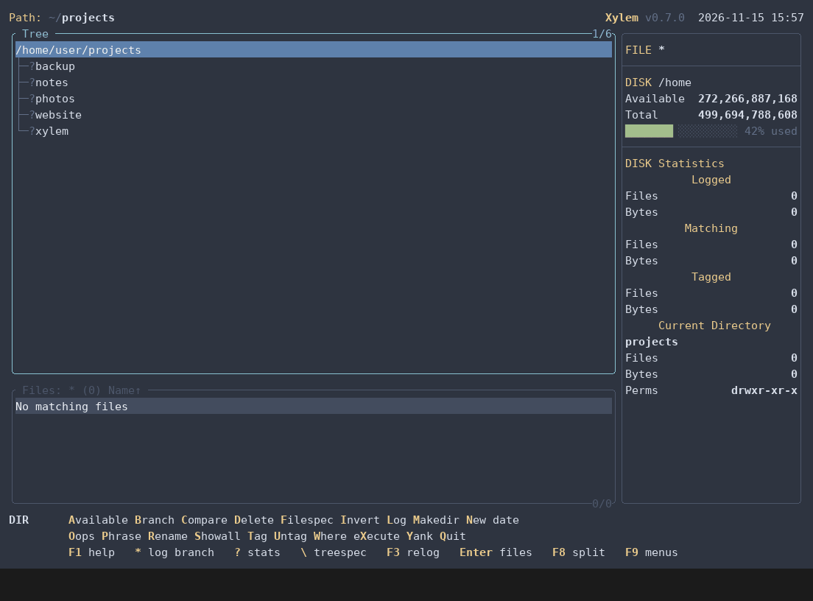

# Dateien aus mehreren Ordnern mit ihren Pfaden kopieren

Diese Anleitung kopiert alle JPG-Dateien unter `~/projects` nach `/mnt/backup`,
jeweils in denselben Unterordner wie im Ursprung. Dieselben Schritte
funktionieren mit Verschieben (Alt+M).

## Schritte

1. Setzen Sie den Cursor im Baum auf `projects`.
2. Drücken Sie `B`. Xylem liest den Zweig ein und das Dateifenster listet die
   Dateien von `projects` und aller darunter liegenden Ordner auf. Bei großen
   Zweigen zeigt die Fußzeile den Fortschritt an; Esc bricht ab.
3. Drücken Sie `F`, geben Sie `*.jpg` ein und drücken Sie Enter. Die Liste
   enthält nur noch die JPGs.
4. Drücken Sie Ctrl+T. Jede Datei in der Liste wird markiert (`■`).
5. Drücken Sie Alt+C. Die Eingabezeile fragt nach dem Ziel.
6. Geben Sie `/mnt/backup` ein. Beachten Sie vor dem Drücken von Enter den
   angezeigten Pfadmodus und drücken Sie **F7**, bis dort `Relative` steht.
7. Drücken Sie Enter. Falls `/mnt/backup` nicht existiert, fragt Xylem vor dem
   Erstellen nach.

Die Leiste unter dem Bildschirm zeigt den aktuellen Schritt und seine Tasten an.

## Welcher Pfadmodus gewählt werden sollte

Schritt 6 bestimmt, wo jeder Pfad unter dem Ziel beginnt. Für
`~/projects/photos/2025/trip/DSC_01.jpg` bei geöffnetem Branch auf `projects`:

| Modus | Die Datei wird geschrieben nach |
|---|---|
| Full | `/mnt/backup/home/user/projects/photos/2025/trip/DSC_01.jpg` |
| Tree | `/mnt/backup/` und der Pfad ab der Wurzel des Xylem-Baums |
| Current | `/mnt/backup/projects/photos/2025/trip/DSC_01.jpg` |
| Relative | `/mnt/backup/photos/2025/trip/DSC_01.jpg` |

Die Eingabezeile startet standardmäßig im Modus `Full`, sofern `copy_paths` in
der Konfiguration nichts anderes festlegt.

## Varianten

- Ohne Pfade: Ctrl+C statt Alt+C legt alle JPGs direkt in `/mnt/backup` ab. Zwei
  gleichnamige Dateien kollidieren dann und Xylem fragt für jede nach.
- Nach Datum oder Größe: In Schritt 3 behält `*.jpg,>TODAY-30` die in den
  letzten 30 Tagen geänderten JPGs. [Filespec](filespec.md) beschreibt die
  Syntax.
- Von der gesamten Festplatte: Mehr einlesen mit `*`, dann in Schritt 2 `S`
  (Showall) drücken.
- Manuelle Auswahl: Schritt 4 überspringen und jede Datei einzeln mit `T`
  markieren.

## Wenn das Ergebnis unerwartet ist

- **Alt+C startet einen Vergleich (Compare).** Der Fokus liegt im Baum. Alt+C
  kopiert mit Pfaden nur im Dateifenster; drücken Sie Enter, um dorthin zu
  wechseln.
- **Dateien fehlen in der Liste.** Ein zuvor gesetzter Filespec ist noch aktiv.
  Er wird im Titel des Dateifensters angezeigt; `F`, `*`, Enter setzt ihn
  zurück.
- **Die Ordner im Ziel beginnen bei `/home`.** Es war der Modus `Full` aktiv.
  Siehe Schritt 6.

Ctrl+U hebt alle Markierungen auf und `B` kehrt zur Liste des Verzeichnisses
allein zurück.

Siehe auch: [Kopieren und Verschieben](copy-move.md),
[Markierungen und Gruppenoperationen](tagging.md),
[das Baumfenster](tree.md).
