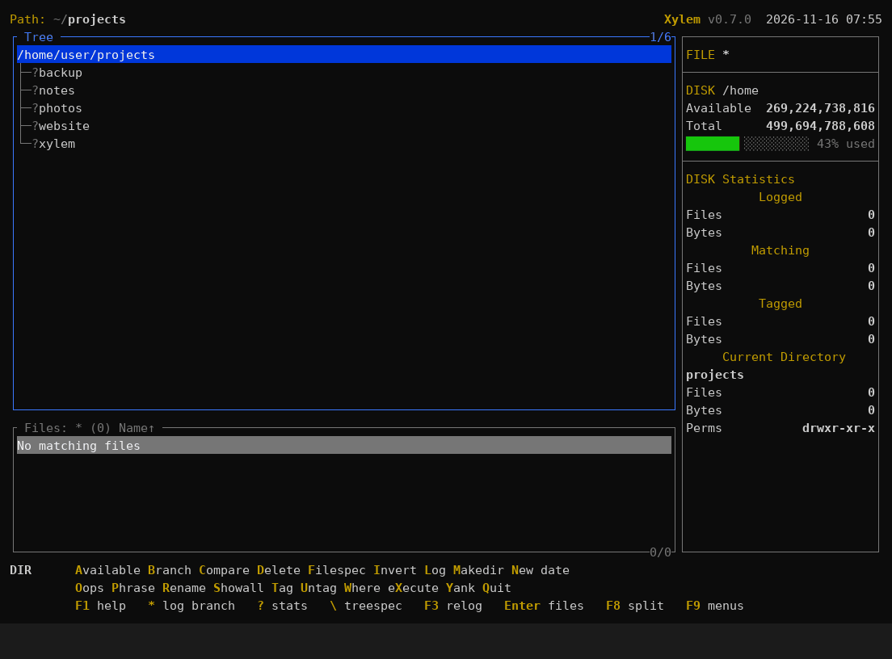

# Dateien von einem anderen Rechner per SSH kopieren

Diese Anleitung zeigt `deploy@webserver` neben diesem Rechner an und kopiert
drei Sicherungsdateien davon in ein lokales Verzeichnis.

## Schritte

1. Drücken Sie F8. Der Bildschirm teilt sich in zwei Fenster, beide im
   aktuellen Verzeichnis. Das linke Fenster hat den Fokus.
2. Drücken Sie `L`, geben Sie `deploy@webserver:` ein und drücken Sie Enter. Das
   linke Fenster zeigt nun das Home-Verzeichnis dieses Benutzers auf jenem
   Rechner.
3. Setzen Sie den Cursor auf `backups`, drücken Sie → zum Einlesen und Enter,
   um zu dessen Dateien zu wechseln.
4. Drücken Sie `T` auf jeder Datei, die Sie kopieren möchten.
5. Drücken Sie Ctrl+C. Die Eingabe schlägt das Verzeichnis des anderen Fensters
   vor.
6. Drücken Sie Enter.

Die Fußzeile zeigt `Copied 3 of 3 files` an.

## Die Adresse

| Adresse | Öffnet |
|---|---|
| `user@host:` | das Home-Verzeichnis |
| `user@host:/srv/www` | dieses Verzeichnis |
| `ssh://user@host:2222/srv/www` | dasselbe auf einem anderen Port |
| `docker://container/path` | einen laufenden Container über `docker exec` |

Xylem verwendet Ihr eigenes `ssh`-Programm. Host-Aliase, Schlüssel, der
SSH-Agent und Einträge in `known_hosts` aus `~/.ssh/config` werden berücksichtigt;
auf dem entfernten Rechner wird nichts installiert.

## Passwörter

Fragt ssh nach einem Passwort oder einer Passphrase, erscheint die Abfrage in
der Fußzeile und die Eingabe bleibt unsichtbar. Xylem leitet sie an ssh weiter
ohne sie zu speichern. Bei einem erstmals kontaktierten Host zeigt die Fußzeile
den Fingerprint des Schlüssels und wartet auf `yes`.

## In die Gegenrichtung

Um auf den entfernten Rechner zu kopieren, wechseln Sie mit Tab in das lokale
Fenster, markieren die Dateien und drücken Ctrl+C: Die Eingabe schlägt das
Verzeichnis des entfernten Fensters vor. Move, Rename, Delete, Makedir,
Attributes und New date funktionieren auf der Gegenseite ebenfalls.

## Wenn das Ergebnis unerwartet ist

- **Das Dateifenster zeigt `Not logged`.** Das Verzeichnis wurde nicht
  eingelesen. Gehen Sie mit Esc zurück und drücken Sie → darauf. Schritt 3
  erledigt dies.
- **Ctrl+C fragt nach einem Ziel ohne Vorschlag.** Der Bildschirm ist nicht
  geteilt. Geben Sie einen lokalen Pfad ein oder drücken Sie vorher F8.
- **Edit und eXecute fehlen im Menü.** Sie funktionieren nicht auf entfernten
  Rechnern. Alt+X öffnet dort eine Shell.
- **Es gibt keinen Papierkorb.** Delete auf entfernten Rechnern löscht
  unwiderruflich und die Sicherheitsabfrage weist darauf hin.

Um später ohne erneute Adresseingabe zurückzukehren, speichern Sie das
Verzeichnis mit Ctrl+F11 als Lesezeichen ab.

Siehe auch: [entfernte Rechner (SSH)](remote.md),
[geteilter Bildschirm](split.md), [Lesezeichen](bookmarks.md).
