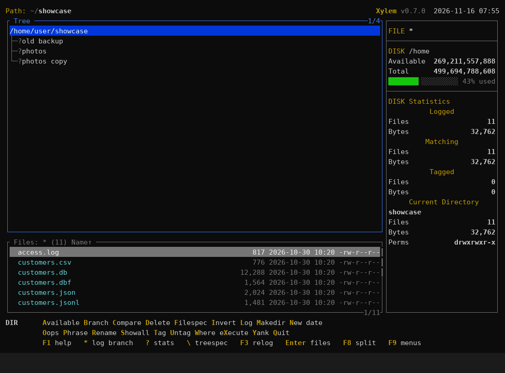

# Eine CSV-Datei oder Tabelle mit SQL filtern

Diese Anleitung öffnet `customers.csv` als Tabelle und behält die Zeilen, deren
Plan `team` ist oder deren Kontostand über 1000 liegt.

## Schritte

1. Setzen Sie den Cursor im Dateifenster auf `customers.csv` und drücken Sie
   `V`. Der Betrachter zeigt die Datei als Tabelle an, mit der ersten Zeile als
   Spaltennamen.
2. Drücken Sie `&`. Die Eingabezeile fragt nach einer Bedingung.
3. Geben Sie `plan = 'team' OR balance > 1000` ein und drücken Sie Enter.



Die Fußzeile zeigt `Filter matched 3 rows`. Die Zeilen behalten ihre
Zeilennummern aus der Datei. Ein Druck auf `&` mit leerer Eingabe zeigt wieder
alle Zeilen an.

## Welche Dateien sich als Tabelle öffnen

| Format | Erweiterungen |
|---|---|
| CSV, TSV | `.csv` `.tsv` `.tab` |
| JSON Lines | `.jsonl` `.ndjson` |
| Tabellenkalkulationen | `.xlsx` `.xls` `.xlsb` `.ods` |
| dBase | `.dbf` |
| SQLite | `.db` `.sqlite` `.sqlite3` |
| Parquet | `.parquet` |

Die Datei muss auf der lokalen Festplatte liegen. Eine Datei auf einem
entfernten Rechner oder in einem Archiv öffnet sich als normaler Text.

## Die Bedingung formulieren

| Zeilen behalten, in denen | Bedingung |
|---|---|
| eine Spalte einem Text entspricht | `plan = 'team'` |
| eine Zahl in einem Bereich liegt | `balance >= 0 AND balance < 100` |
| ein Text mit etwas beginnt | `name LIKE 'Ana%'` |
| ein Text unabhängig von Groß-/Kleinschreibung vorkommt | `city ILIKE '%paulo%'` |
| eine Zelle leer ist | `email IS NULL` |
| eine Spalte keinen nutzbaren Namen hat | Spaltenbuchstaben nutzen: `C = 'pro'` |

Eine Zelle, die wie eine Zahl aussieht, wird als Zahl behandelt: schreiben Sie
`code = 7`, nicht `code = '7'`. [Der SQL-Filter](viewer.md#der-sql-filter)
beschreibt alle Operatoren.

## In einer Tabellenkalkulation oder Datenbank

- Eine Tabellenkalkulation hat keine Spaltennamen: Die Spalten heißen `A`, `B`,
  `C`. Die Tasten `[` und `]` wechseln zwischen Tabellenblättern, und Tab listet
  sie auf.
- In einer SQLite-Datenbank listet Tab die Tabellen und Views auf. Dieselbe
  Eingabezeile nimmt auch eine vollständige Abfrage an, die mit `SELECT` oder
  `WITH` beginnt:

```
SELECT plan, count(*), sum(balance) FROM customers GROUP BY plan
```

Xylem liest die Datenbank nur. Befehle wie `UPDATE` oder `DELETE` werden
abgewiesen.

## Das Ergebnis speichern

Ctrl+B schreibt die vom Filter behaltenen Zeilen in eine Datei: CSV, JSON, HTML,
ein SQL-Skript oder eine SQLite-Tabelle. [Batch](execute.md) beschreibt die
Formate.

## Wenn das Ergebnis unerwartet ist

- **`SQL error`.** Die Bedingung konnte nicht gelesen werden. Der zuvor aktive
  Filter bleibt bestehen.
- **Keine Zeile passt zu einer sichtbaren Spalte.** Ein nicht existierender
  Spaltenname gilt als leer (*NULL*), ohne Fehler. Prüfen Sie die Schreibweise
  oder nutzen Sie den Spaltenbuchstaben.
- **Die Datei öffnet sich als Text.** Ihre Erweiterung steht nicht in obiger
  Tabelle, oder die Datei ist komprimiert, entfernt oder liegt in einem Archiv.
  `T` schaltet zwischen Tabelle und Text um, sofern beides vorliegt.

Siehe auch: [der Betrachter](viewer.md),
[Dateien mit SQL auswählen](howto-sql-filter.md).
