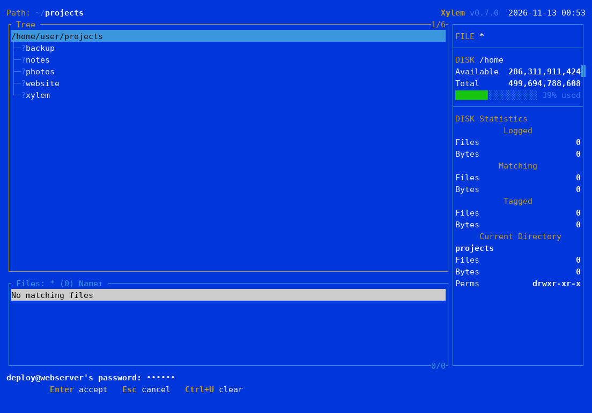
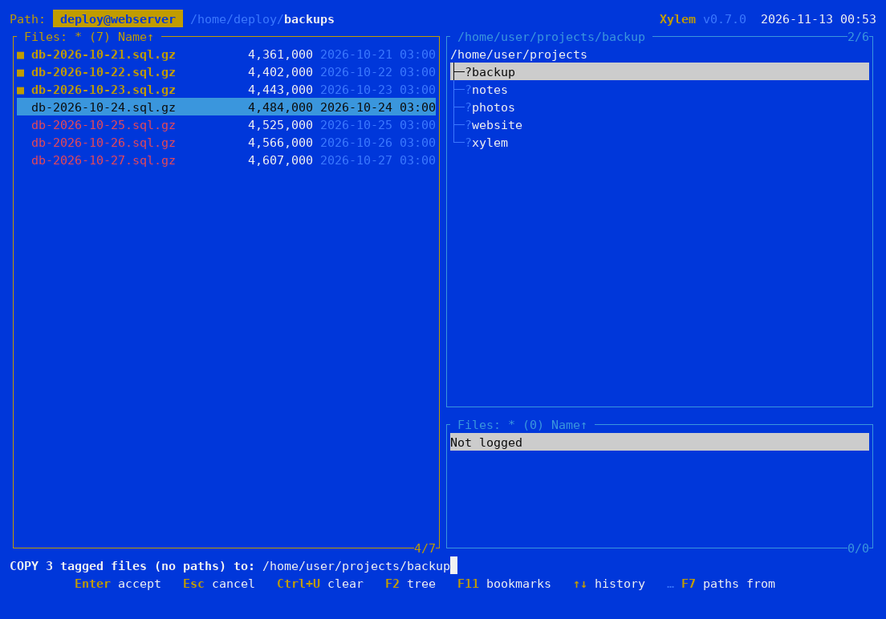
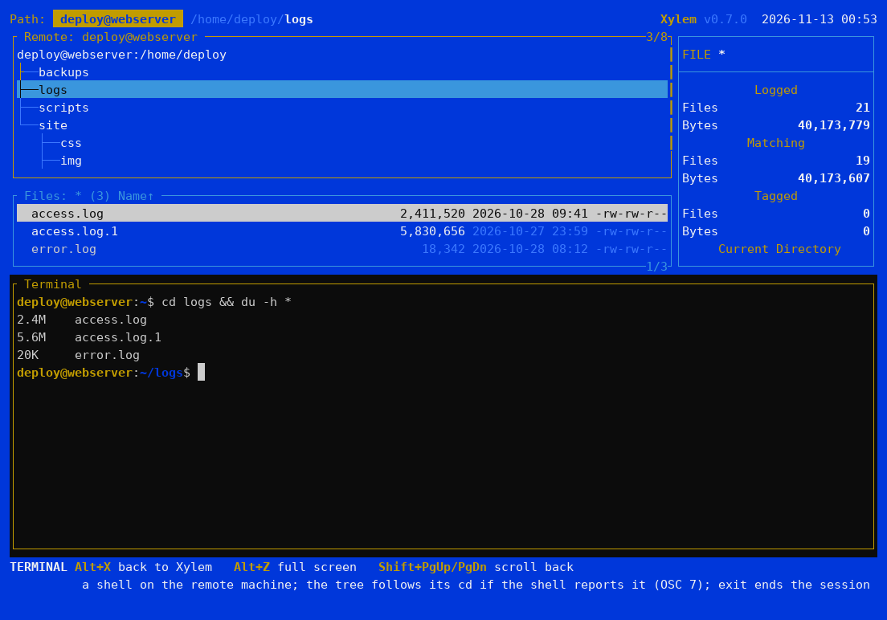

# Entfernte Rechner (SSH)

Xylem kann die Dateien eines anderen, über SSH erreichbaren Rechners als Baum
anzeigen: entweder allein oder neben dem lokalen Rechner bei [geteiltem
Bildschirm](split.md).

## Verbindung öffnen

Geben Sie die Adresse unter `L` ([Log](treespec.md)) ein oder übergeben Sie sie
beim Start auf der Befehlszeile an `xy`:

- `user@host:` — das Home-Verzeichnis; `user@host:/srv/www` — dieses
  Verzeichnis;
- `ssh://[user@]host[:port][/pfad]` — mit Portangabe oder ohne Benutzernamen
  (wie in Ihrer `~/.ssh/config`).

Xylem startet Ihr eigenes `ssh`-Programm, sodass alles, was Sie im Terminal
nutzen, genauso funktioniert: `~/.ssh/config` (Host-Aliase, Ports, ProxyJump),
Schlüssel, der SSH-Agent und `known_hosts`. Auf dem entfernten Rechner muss
nichts installiert werden: Xylem spricht SFTP, was jeder SSH-Server beherrscht
(Linux, BSD, macOS, Windows).

## Passwörter und Rückfragen

Wenn ssh etwas abfragt, erscheint die Frage in der Fußzeile:

- ein **Passwort** oder die **Passphrase** eines Schlüssels: wird verdeckt
  eingegeben; Enter sendet die Eingabe, Esc bricht die Verbindung ab. Xylem
  reicht sie an ssh weiter und speichert nichts.
- ein **unbekannter Host**: der Host und der Fingerabdruck seines Schlüssels,
  zur Prüfung vor der Antwort `yes` (ssh merkt ihn sich anschließend wie
  gewohnt in `known_hosts`).

`Esc` während des Verbindungsaufbaus bricht ab. Mit Schlüssel und Agent erfolgt
keine Rückfrage.



## Was funktioniert

Der Baum, das Dateifenster, [Filespec](filespec.md), Branch, Showall,
Markierungen, [der Betrachter](viewer.md), [Ctrl+S und Ctrl+V](search.md),
Autoview, Info (Alt+I), die Anzeigemodi (owner zeigt Benutzer- und Gruppen-IDs
an, da SFTP diese überträgt), [Vergleichen](compare.md) und Öffnen (`O` lädt
eine Kopie herunter und öffnet sie lokal).

**Kopieren** holt Dateien auf diesen Rechner, mitsamt ihren Berechtigungen und
Zeitstempeln (sekundengenau, wie SFTP sie liefert); bei geteiltem Bildschirm
wird das Fenster dieses Rechners als Ziel vorgeschlagen. Alt+C (mit Pfaden)
funktioniert ebenfalls, wobei die Pfade an der Wurzel des entfernten Fensters
beginnen.



**Umbenennen** (eine Datei, ein Verzeichnis oder die markierten Dateien mit
einer Maske) und **Verzeichnis erstellen** funktionieren auf dem entfernten
Rechner wie hier. Eine Umbenennung ersetzt nie eine Datei, ohne zu fragen;
nach einem Ja ersetzt der Server sie in einem Schritt, wenn er es kann
(OpenSSH kann es), sonst sagt Xylem das und lässt beide stehen.

**Kopieren auf den entfernten Rechner** funktioniert ebenfalls: aus dem
Fenster dieses Rechners; bei geteiltem Bildschirm wird das entfernte Fenster
als Ziel vorgeschlagen; oder Sie geben einen Pfad des entfernten Fensters oder
seine Adresse ein (`benutzer@host:/srv/www`, innerhalb des Ordners, mit dem das
Fenster geöffnet wurde). Jede Datei wird in eine temporäre Datei neben dem Ziel
geschrieben, auf ihre Größe geprüft, erhält ihre Berechtigungen (ohne setuid
und setgid) und ihr Datum und wird erst dann an ihren Platz gesetzt; Esc
entfernt die temporäre Datei. Kopieren innerhalb des entfernten Rechners
funktioniert genauso. Symbolische Links werden dort nicht neu angelegt, und
das wird gemeldet.

**Verschieben** funktioniert in alle Richtungen: von hier auf den entfernten
Rechner und zurück (das Original wird erst entfernt, wenn die Kopie an ihrem
Platz und geprüft ist) und innerhalb des entfernten Rechners (dort eine
Umbenennung). **Löschen**, **Prune** und dieselben Aktionen in Usage
funktionieren ebenfalls. Auf einem entfernten Rechner gibt es **keinen
Papierkorb**: Die Rückfrage sagt das, und Oops hat nichts wiederherzustellen.
Nichts wird über einen symbolischen Link entfernt: Ein Link wird als er selbst
entfernt. Prune lässt andere Datenträger aus, die im Zweig eingehängt sind;
sie werden über die `statvfs`-Erweiterung von OpenSSH unterschieden, und auf
einem Server ohne sie wird Prune abgelehnt.

**Berechtigungen** nehmen oktale Werte (`644`) an, wie ein Unix-Rechner, auch
von Windows aus; **Datum ändern** setzt das Datum auf die Sekunde genau. Keins
von beiden wirkt über einen symbolischen Link. [Duplikate](duplicates.md)
funktioniert dort ebenfalls.

Bearbeiten und Ausführen fehlen noch. F3 liest ein Verzeichnis neu ein; eine automatische Aktualisierung
gibt es nicht.

**F8** in einem entfernten Fenster öffnet ein zweites Fenster auf dem lokalen
Rechner (in dem Ordner, in dem Xylem gestartet wurde), sodass Sie beide Seiten
nebeneinander haben.

## Das Terminal auf dem entfernten Rechner

**Alt+X** in einem entfernten Fenster öffnet eine Shell auf diesem Rechner
(`ssh -t`), beginnend im Verzeichnis des Fensters; in einem lokalen Fenster wie
gewohnt die lokale Shell (jede läuft weiter, während die andere sichtbar ist).
Unter Linux und macOS nutzt die entfernte Shell die bereits bestehende
Verbindung mit, sodass das Passwort nicht erneut abgefragt wird; unter Windows
fragt ssh im Terminal danach.



Der Baum folgt dem `cd` der entfernten Shell, wenn diese ihr Verzeichnis über
die Sequenz OSC 7 meldet. Viele Systeme tun dies bereits; für bash fügen Sie
Folgendes in die `~/.bashrc` **auf dem entfernten Rechner** ein:

```bash
PROMPT_COMMAND='printf "\033]7;file://%s%s\007" "$HOSTNAME" "$PWD"'
```

Xylem tippt niemals automatisch Befehle in eine entfernte Shell (es kann nicht
erkennen, ob dort gerade ein Programm läuft), und Alt+O sowie `$XY_TAGGED`
stehen nur für lokale Terminals zur Verfügung. Beim Beenden mit geöffnetem
entfernten Terminal fragt Xylem zuerst nach.

## Beim Login gestartetes tmux oder screen

Manche Benutzer starten beim Einloggen per SSH automatisch tmux (oder screen)
aus der `~/.bashrc` auf dem entfernten Rechner, damit eine abgebrochene
Verbindung (instabiles WLAN, sich neu verbindendes VPN) laufende Programme
nicht beendet: Ein erneutes Einloggen nimmt dieselbe Sitzung wieder auf. Zum
Beispiel:

```bash
if [ -n "$SSH_CONNECTION" ] && [ -z "$TMUX" ]; then
    tmux attach-session -t remote 2>/dev/null || tmux new-session -s remote
fi
```

Dann öffnet sich auch das entfernte Terminal von Xylem innerhalb von tmux.
Alles funktioniert, außer dass **der Baum dem `cd` der Shell nicht folgt**:
tmux sitzt zwischen der Shell und Xylem, behält die Sequenz OSC 7 für sich und
reicht sie nicht weiter.

Die entfernte Shell von Xylem startet genau wie die lokale mit gesetztem
`XY_TERMINAL=1`, sodass das Login-Skript beide Fälle unterscheiden kann. Wenn
Sie diese Prüfung zur Bedingung hinzufügen, bleibt tmux für Ihr normales `ssh`
erhalten und wird ausgelassen, wenn Xylem sich verbindet:

```bash
if [ -n "$SSH_CONNECTION" ] && [ -z "$TMUX" ] && [ -z "$XY_TERMINAL" ]; then
    tmux attach-session -t remote 2>/dev/null || tmux new-session -s remote
fi
```

Innerhalb von Xylem benötigt die Shell kein tmux, um weiterzulaufen: Sie bleibt
aktiv, solange Xylem geöffnet ist, und falls die Verbindung abbricht, schließt
sich ohnehin auch das entfernte Fenster.

## Container (Docker, Podman)

Ein Container auf diesem Rechner öffnet sich genauso, ohne `sshd` darin:

- `docker://container` — sein Arbeitsverzeichnis; `docker://container/app` —
  dieses Verzeichnis; `docker://benutzer@container/app` — als dieser Benutzer
  (`docker exec -u`).

Xylem ruft `docker exec` auf und startet im Container dessen eigenen
`sftp-server`, dasselbe Programm, das ein SSH-Server verwendet. Die meisten
Images haben ihn nicht: Installieren Sie ihn im Container (`apk add
openssh-sftp-server` unter Alpine, `apt install openssh-sftp-server` unter
Debian und Ubuntu, `dnf install openssh-server` unter Fedora), sonst meldet
Xylem, dass er fehlt. Das Image braucht `sh`; Distroless-Images fallen daher weg.

Alles oben Beschriebene funktioniert dort wie auf einem entfernten Rechner, und
**Alt+X** öffnet eine Shell im Container, im Ordner des Fensters. Mit
**Podman** starten Sie Xylem mit `XY_DOCKER=podman`. `DOCKER_HOST` und
Docker-Kontexte gelten wie gewohnt.

Xylem ruft immer nur `docker exec` auf: Es startet, ändert oder lädt keinen
Container. Was Sie schreiben, landet im Container, außer in Ordnern, die von
diesem Rechner eingebunden sind (`-v`): Das sind Dateien dieses Rechners.

Für Google Drive, S3 und andere Cloud-Dienste siehe [Cloud-Speicher](cloud.md).
