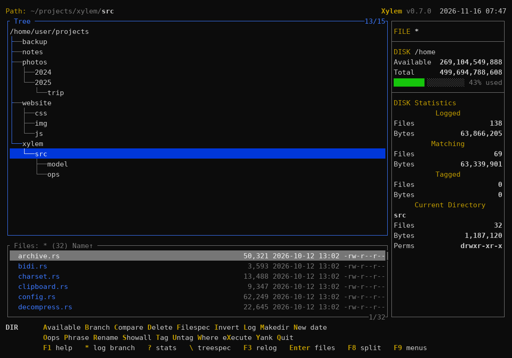

# Der Bildschirm



```
 Path: ~/projects/xylem/src            Xylem v0.7.0  2026-11-13 00:49   1
┌ Tree ──────────────────────────────────────┐ ┌──────────────────────┐
│ /home/user/projects                        │ │ FILE *               │
│ ├──notes                                   │ │                      │
│ ├──photos                              2   │ │ DISK /home       4   │
│ └──xylem                                   │ │ Available   286,274… │
│    └──src                                  │ │                      │
└────────────────────────────────────────────┘ │ DISK Statistics      │
┌ Files: * (30) Name↑ ───────────────────────┐ │ Logged, Matching,    │
│ archive.rs      50,321 2026-10-12 13:02    │ │ Tagged               │
│ bidi.rs          3,593 2026-10-12 13:02  3 │ │ Current Directory    │
└────────────────────────────────────────────┘ └──────────────────────┘
 DIR   Available Branch Compare Delete Filespec …                       5
       F1 help   * log branch   ? stats   \ treespec …
```

| | Bereich | Was angezeigt wird |
|---|---|---|
| 1 | Kopfzeile | Die Abzeichen einer Root- oder SSH-Sitzung (siehe *Root und SSH* unten), Pfad des Verzeichnisses unter dem Cursor, Programmname und -version, Datum und Uhrzeit. Name und Version entfallen bei weniger als 72 Spalten. |
| 2 | Baum | Die eingelesenen Verzeichnisse. Die Zahl im oberen Rahmen nennt Cursor- und Gesamtzeilenzahl. |
| 3 | Dateifenster | Dateien des Verzeichnisses unter dem Baum-Cursor. Der Titel enthält Filespec, Dateianzahl und Sortierung. |
| 4 | Statistiken | Filespec, Festplatte sowie die unten beschriebenen Datei- und Byte-Zähler. |
| 5 | Fußzeile | Das Menü des aktiven Fensters. Eine Eingabezeile oder Meldung belegt die erste Zeile, falls vorhanden. |

Das aktive Fenster mit dem Fokus hebt sich durch einen hellen Rahmen ab.

## Root und SSH

Läuft Xylem mit mehr Rechten als üblich oder auf einem anderen Rechner, zeigt
der Bildschirm das an:

- **`ROOT`** (**`ADMIN`** unter Windows, als Administrator ausgeführt), in
  Rot, am linken Ende der Kopfzeile. Alle Fensterrahmen werden ebenfalls rot,
  und das Fenster mit dem Fokus erhält einen dicken Rahmen. Die Fragen von
  Delete, Prune, Copy, Move, Rename, Attributes und New date beginnen mit
  demselben Abzeichen, wenn sie Dateien auf diesem Rechner ändern können; auf
  dem Rechner eines entfernten Fensters handelt der Benutzer der Verbindung,
  nicht root, und das Abzeichen entfällt.
- **`SSH Rechner`**, danach: Xylem läuft in einer SSH-Sitzung, auf `Rechner`,
  nicht auf dem Computer vor Ihnen. Es erkennt das an den Variablen
  `SSH_CONNECTION`, `SSH_CLIENT` und `SSH_TTY` oder, unter Linux, an einem
  `sshd` oder `mosh-server` unter den Prozessen, die es gestartet haben; das
  funktioniert auch, nachdem `sudo` oder `su -` die Variablen gelöscht haben.

In tmux oder screen gelten die Variablen der Sitzung, die den tmux- oder
screen-Server gestartet hat. Unter macOS wird die SSH-Sitzung mit `sudo` nicht
erkannt.

## Der Baum

Jede Zeile steht für ein Verzeichnis. Das Verbindungssymbol vor dem Namen
signalisiert den Zustand:

| Symbol | Bedeutung |
|---|---|
| `├──` | eingelesen und aufgeklappt oder ohne Unterverzeichnisse |
| `├─+` | eingelesen, mit zugeklappten Unterverzeichnissen |
| `├─?` | nicht eingelesen: Dateien und Unterverzeichnisse noch nicht gelesen |

Alt+K blendet eine Spalte mit Größe, Dateianzahl oder prozentualem Anteil jedes
Verzeichnisses ein. Siehe [Informationen](info.md).

## Das Dateifenster: klein und groß

Befindet sich der Fokus im Baum, bleibt das Dateifenster verkleinert darunter
und folgt dem Baum-Cursor. **Enter** übergibt ihm den Fokus und vergrößert es
auf die gesamte Bildschirmhöhe; der Baum bleibt bis Enter oder Esc
ausgeblendet.

`B` (Branch) und `S` (Showall) öffnen ebenfalls das große Dateifenster und
fassen Dateien mehrerer Verzeichnisse zusammen. Der Titel beginnt dann mit
`Branch:` oder `Showall:`.

Alt+F ändert die Darstellungsart der Zeilen: Namen in Spalten, Namen und Größen,
Details (Größe, Datum und Berechtigungen), Besitzer, Typ oder lange Namen. Siehe
[das Dateifenster](files.md).

## Die Statistiken

| Block | Was gezählt wird |
|---|---|
| FILE | der aktive Filespec; `*` zeigt alle Dateien an |
| DISK | das Dateisystem des aktuellen Verzeichnisses: freie und gesamte Bytes sowie prozentuale Belegung |
| Logged | die in diesem Fenster in den Speicher eingelesenen Dateien |
| Matching | die eingelesenen Dateien, die dem Filespec entsprechen |
| Tagged | die markierten Dateien, mit Balken für ihren Anteil an den übereinstimmenden Bytes |
| Current Directory | Dateien und Bytes des Verzeichnisses unter dem Cursor sowie dessen Berechtigungen |

`?` ersetzt den Bildschirm durch die vollständigen Statistiken: Maschine,
Netzwerk und Xylem selbst. Siehe [Informationen](info.md).

## Was das Bildschirmlayout verändert

| Taste | Wirkung |
|---|---|
| F8 | Zwei Fenster nebeneinander, jedes mit eigenem Baum und Dateifenster. Tab wechselt zwischen ihnen. [Geteilter Bildschirm](split.md) |
| F7 | Im Dateifenster belegt die Liste die linken 40% der Breite und der Inhalt der Datei unter dem Cursor den Rest. [Autoview](files.md) |
| Alt+X | Ein Terminal belegt den unteren Teil des Bildschirms. Alt+Z vergrößert es auf Vollbild. [Das integrierte Terminal](terminal.md) |
| Alt+U | Die Belegungsansicht ersetzt Baum und Dateifenster. [Speicherplatzbelegung](usage.md) |

Siehe auch: [die Menüs](menus.md), [das Baumfenster](tree.md).
