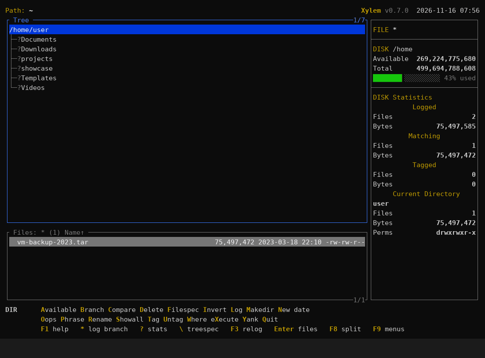

# Encontrar lo que llena el disco

Este procedimiento desciende desde el directorio personal hasta los archivos más
grandes y elimina uno de ellos.

## Paso a paso

1. En el árbol, coloca el cursor sobre el directorio a examinar y pulsa Alt+U.
   Xylem registra la rama y lista sus carpetas y archivos según el espacio que
   ocupan, de mayor a menor.
2. Navega hasta una carpeta (su nombre empieza por `/`) y pulsa Enter para
   listar su contenido.
3. Pulsa Enter de nuevo sobre la carpeta más grande y repite hasta que la lista
   muestre archivos.
4. Navega hasta el archivo que deseas eliminar y pulsa Del. Xylem pide
   confirmación antes de eliminarlo.
5. Pulsa `T` para enviarlo a la papelera y después `Y`.



El pie muestra `Trashed 1 of 1 files` y los porcentajes se recalculan sin ese
archivo.

## Leer una línea

```
     19.0 MiB ████████████████    51%   projects-2026-10.tar.gz
```

| Parte | Significado |
|---|---|
| `19.0 MiB` | el espacio que ocupa el elemento en el disco |
| la barra | el elemento respecto al mayor elemento de la lista |
| `51%` | la proporción del elemento dentro del directorio listado |
| el nombre | una carpeta cuando comienza por `/` |

## Teclas en la lista

| Tecla | Qué hace |
|---|---|
| Enter | entra en la carpeta; sobre un archivo, lo abre en el visor |
| Backspace o ← | regresa a la carpeta superior |
| `T` | marca el archivo, o todos los archivos de la carpeta |
| Ctrl+D | elimina los archivos marcados |
| Alt+P | elimina la carpeta con todo su contenido, permanentemente |
| `D` | busca duplicados en la carpeta listada |
| `\` | cierra la lista y sitúa el cursor del árbol sobre la carpeta listada |
| Esc | cierra la lista |

## Cuando no hace lo que esperas

- **Una línea comienza por `>`.** Es otro sistema de archivos montado allí. No se
  suma al total y pulsar Enter sobre él abre una lista propia para ese disco.
- **Una línea comienza por `!` o `.`.** La carpeta, o algún elemento dentro de
  ella, no pudo leerse, generalmente por falta de permisos. Puede ocupar más
  espacio del mostrado.
- **Los tamaños difieren de la ventana de archivos.** Esta lista muestra el
  espacio en disco, en bloques completos. `A` cambia a los tamaños propios de los
  archivos.

## Una unidad en la nube

Los mismos pasos funcionan en una carpeta de Google Drive o S3 montada por
rclone. [Almacenamiento en la nube (rclone)](cloud.md) describe la configuración
y las diferencias en esos servicios.

Véase también: [uso de disco](usage.md),
[encontrar duplicados](howto-duplicates.md).
