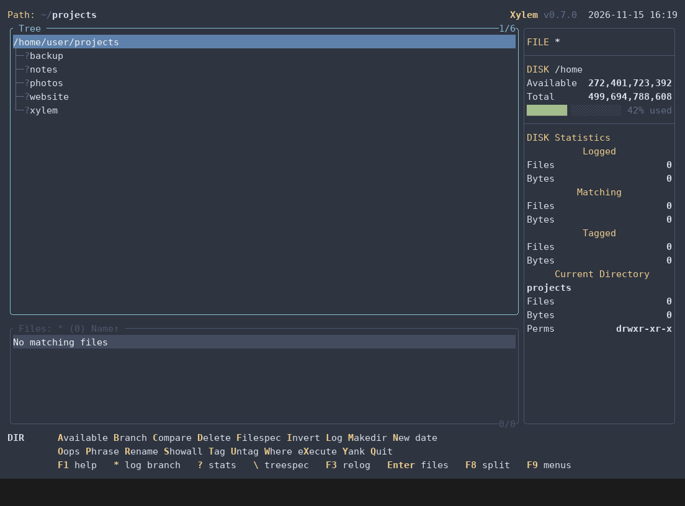

# Elegir archivos con una condición SQL

Este procedimiento lista los archivos JPG mayores de 1 MB ubicados bajo
`~/projects` y los marca, listos para Copiar, Mover o Eliminar.

## Paso a paso

1. En el árbol, coloca el cursor sobre `projects` y pulsa `B`. La ventana de
   archivos lista los archivos de toda la rama.
2. Pulsa `W`. El prompt solicita la condición.
3. Escribe `ext = 'jpg' AND size > 1000000` y pulsa Enter. La lista conserva los
   archivos que cumplen la condición y el pie indica cuántos son.
4. Pulsa Ctrl+T. Los archivos de la lista quedan marcados.

El título de la ventana de archivos muestra la condición: `Branch: * where ext =
'jpg' AND size > 1000000 (12)`. Pulsar `W` con el prompt vacío muestra de nuevo
la lista completa; las marcas se conservan.

## Escribir la condición

La condición corresponde a lo que sigue a `WHERE` en una consulta SQL. El texto
va entre comillas simples y los números se escriben enteros.

| Para conservar | Condición |
|---|---|
| archivos modificados en la última semana | `age_days < 7` |
| archivos Markdown y de texto | `ext IN ('md', 'txt')` |
| nombres que empiezan por `report` | `name LIKE 'report%'` |
| archivos no marcados todavía | `NOT tagged` |
| archivos que contienen un texto | `contains('invoice')` |

[Una condición SQL](sql.md#una-condición-sql-w) lista todas las columnas.

## Cuando no hace lo que esperas

- **`No column "jpg"`.** El texto se escribió sin comillas. `ext = jpg` compara
  dos columnas; `ext = 'jpg'` compara con la cadena de texto.
- **Faltan archivos esperados.** `W` solo examina archivos registrados en
  memoria. Abre el Branch primero o registra más carpetas con `*` y usa `S`
  (Showall).
- **Nada cambia.** Ningún archivo cumple la condición y la lista permanece como
  estaba.
- **`contains` pide confirmación antes de ejecutarse.** Lee cada archivo que debe
  comprobar y la pregunta indica cuántos archivos y bytes se leerán.

Véase también: [Filespec](filespec.md),
[Marcas y operaciones en grupo](tagging.md),
[copiar archivos conservando las rutas](howto-copy-with-paths.md).
