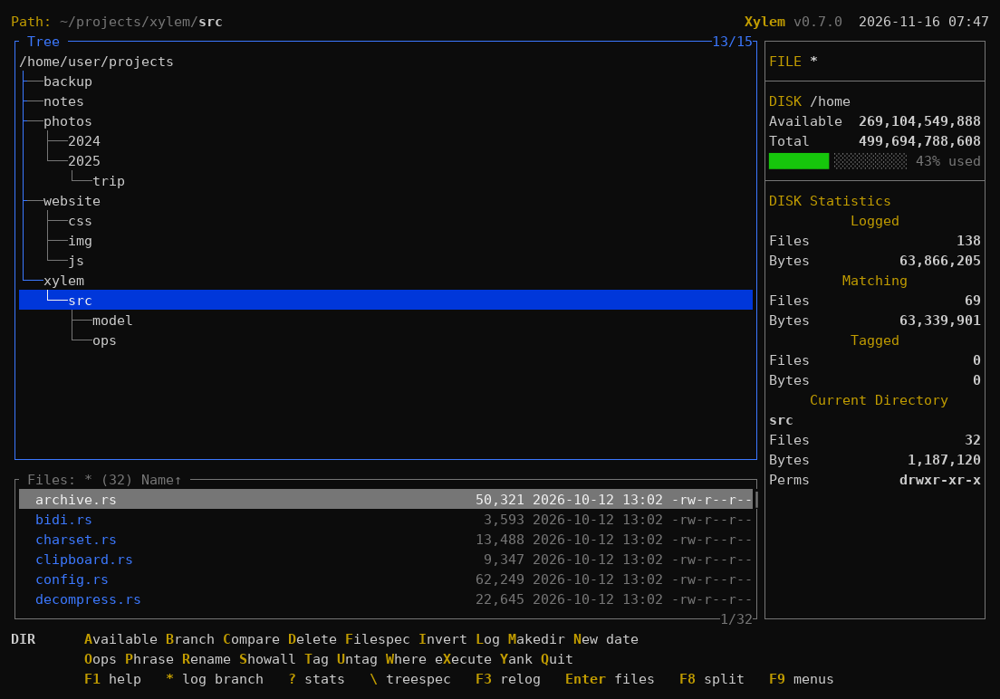

# La pantalla



```
 Path: ~/projects/xylem/src            Xylem v0.7.0  2026-11-13 00:49   1
┌ Tree ──────────────────────────────────────┐ ┌──────────────────────┐
│ /home/user/projects                        │ │ FILE *               │
│ ├──notes                                   │ │                      │
│ ├──photos                              2   │ │ DISK /home       4   │
│ └──xylem                                   │ │ Available   286,274… │
│    └──src                                  │ │                      │
└────────────────────────────────────────────┘ │ DISK Statistics      │
┌ Files: * (30) Name↑ ───────────────────────┐ │ Logged, Matching,    │
│ archive.rs      50,321 2026-10-12 13:02    │ │ Tagged               │
│ bidi.rs          3,593 2026-10-12 13:02  3 │ │ Current Directory    │
└────────────────────────────────────────────┘ └──────────────────────┘
 DIR   Available Branch Compare Delete Filespec …                       5
       F1 help   * log branch   ? stats   \ treespec …
```

| | Parte | Qué muestra |
|---|---|---|
| 1 | Encabezado | Las insignias de una sesión root o SSH (véase *Root y SSH* más abajo), la ruta del directorio bajo el cursor, nombre y versión del programa, fecha y hora. Nombre y versión se omiten por debajo de 72 columnas. |
| 2 | Árbol | Los directorios registrados. El número en el borde superior indica la línea del cursor y el total de líneas. |
| 3 | Ventana de archivos | Los archivos del directorio bajo el cursor del árbol. Su título muestra el Filespec, cantidad de archivos y orden de clasificación. |
| 4 | Estadísticas | El Filespec, el disco y los conteos de archivos y bytes descritos más abajo. |
| 5 | Pie de página | El menú correspondiente a la ventana con el foco. Si hay un prompt o mensaje activo, ocupa la primera línea. |

La ventana activa con el foco presenta un borde resaltado.

## Root y SSH

Cuando Xylem se ejecuta con más poder del habitual, o en otra máquina, la
pantalla lo indica:

- **`ROOT`** (**`ADMIN`** en Windows, ejecutado como Administrador), en rojo,
  en el extremo izquierdo del encabezado. Todos los bordes de las ventanas
  también se vuelven rojos, y la ventana con el foco recibe un borde grueso.
  Las preguntas de Delete, Prune, Copy, Move, Rename, Attributes y New date
  empiezan con la misma insignia cuando pueden modificar archivos de esta
  máquina; en la máquina de una ventana remota actúa el usuario de la
  conexión, no root, y la insignia se omite.
- **`SSH máquina`**, a continuación: Xylem se ejecuta dentro de una sesión
  SSH, en `máquina`, no en el ordenador que tiene delante. Lo sabe por las
  variables `SSH_CONNECTION`, `SSH_CLIENT` y `SSH_TTY` o, en Linux, por un
  `sshd` o `mosh-server` entre los procesos que lo iniciaron, lo que sigue
  funcionando después de que `sudo` o `su -` borren las variables.

Dentro de tmux o screen, las variables son las de la sesión que inició el
servidor de tmux o screen. En macOS, bajo `sudo`, la sesión SSH no se detecta.

## El árbol

Cada línea representa un directorio. El conector antes del nombre indica su
estado:

| Conector | Significado |
|---|---|
| `├──` | registrado, y expandido o sin subdirectorios |
| `├─+` | registrado, con subdirectorios contraídos |
| `├─?` | no registrado: sus archivos y subdirectorios no han sido leídos |

Alt+K añade una columna con el tamaño, número de archivos o porcentaje de cada
directorio. Consulta [información](info.md).

## La ventana de archivos: reducida y ampliada

Con el foco en el árbol, la ventana de archivos permanece en formato reducido
debajo de él y sigue al cursor del árbol. **Enter** le transfiere el foco y la
amplía a toda la altura de la pantalla; el árbol permanece oculto hasta
pulsar Enter o Esc.

`B` (Branch) y `S` (Showall) también abren la ventana de archivos ampliada,
mostrando archivos de más de un directorio. En ese caso, el título comienza por
`Branch:` o `Showall:`.

Alt+F modifica la información mostrada en cada línea: nombres en columnas,
nombres y tamaños, detalles (tamaño, fecha y permisos), propietario, tipo o
nombres largos. Consulta [la ventana de archivos](files.md).

## Las estadísticas

| Bloque | Qué contabiliza |
|---|---|
| FILE | el Filespec activo; `*` muestra todos los archivos |
| DISK | el sistema de archivos del directorio actual: bytes libres, totales y porcentaje en uso |
| Logged | los archivos leídos en memoria en esta ventana |
| Matching | los archivos registrados que cumplen el Filespec |
| Tagged | los archivos marcados, con una barra que ilustra su proporción en bytes |
| Current Directory | cantidad de archivos y bytes del directorio bajo el cursor, y sus permisos |

`?` sustituye la pantalla por las estadísticas completas: la máquina, la red y
el propio Xylem. Consulta [información](info.md).

## Qué altera la disposición de la pantalla

| Tecla | Efecto |
|---|---|
| F8 | Dos ventanas lado a lado, cada una con su árbol y ventana de archivos. Tab alterna entre ellas. [Pantalla dividida](split.md) |
| F7 | En la ventana de archivos, la lista ocupa el 40% izquierdo y el visor muestra el contenido del archivo bajo el cursor en el resto. [Autoview](files.md) |
| Alt+X | Una terminal ocupa la parte inferior de la pantalla. Alt+Z la amplía a pantalla completa. [La terminal integrada](terminal.md) |
| Alt+U | La vista de Uso sustituye al árbol y la ventana de archivos. [Uso de disco](usage.md) |

Véase también: [los menús](menus.md), [la ventana del árbol](tree.md).
