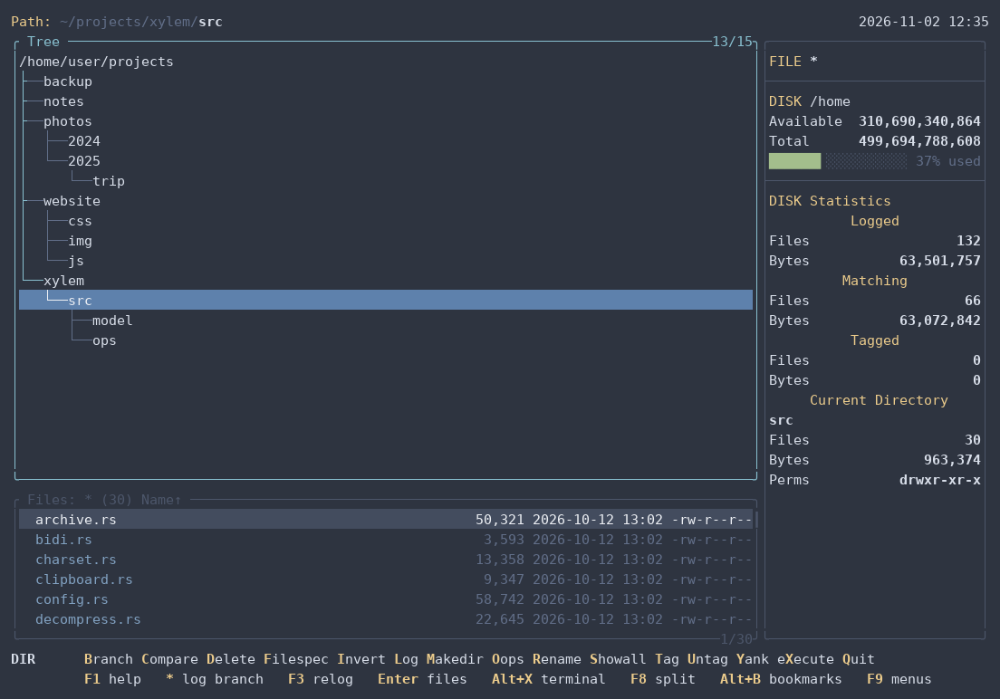

# L'écran



```
 Path: ~/projects/xylem/src            Xylem v0.7.0  2026-11-13 00:49   1
┌ Tree ──────────────────────────────────────┐ ┌──────────────────────┐
│ /home/user/projects                        │ │ FILE *               │
│ ├──notes                                   │ │                      │
│ ├──photos                              2   │ │ DISK /home       4   │
│ └──xylem                                   │ │ Available   286,274… │
│    └──src                                  │ │                      │
└────────────────────────────────────────────┘ │ DISK Statistics      │
┌ Files: * (30) Name↑ ───────────────────────┐ │ Logged, Matching,    │
│ archive.rs      50,321 2026-10-12 13:02    │ │ Tagged               │
│ bidi.rs          3,593 2026-10-12 13:02  3 │ │ Current Directory    │
└────────────────────────────────────────────┘ └──────────────────────┘
 DIR   Available Branch Compare Delete Filespec …                       5
       F1 help   * log branch   ? stats   \ treespec …
```

| | Partie | Ce qu'elle affiche |
|---|---|---|
| 1 | En-tête | Le chemin du répertoire sous le curseur, le nom et la version du programme, la date et l'heure. Le nom et la version disparaissent en dessous de 72 colonnes. |
| 2 | Arborescence | Les répertoires lus. Le nombre sur la bordure supérieure indique la ligne du curseur et le total des lignes. |
| 3 | Fenêtre de fichiers | Les fichiers du répertoire sous le curseur de l'arborescence. Son titre indique le Filespec, le nombre de fichiers et l'ordre de tri. |
| 4 | Statistiques | Le Filespec, le disque et les décomptes de fichiers et d'octets décrits ci-dessous. |
| 5 | Pied de page | Le menu de la fenêtre active. Une invite ou un message en occupe la première ligne lorsqu'il y en a un. |

La fenêtre ayant le focus se distingue par sa bordure lumineuse.

## L'arborescence

Chaque ligne représente un répertoire. Le connecteur précédant le nom indique
son état :

| Connecteur | Signification |
|---|---|
| `├──` | lu en mémoire, et déplié ou sans sous-répertoire |
| `├─+` | lu en mémoire, avec sous-répertoires repliés |
| `├─?` | non lu : ses fichiers et sous-répertoires n'ont pas encore été explorés |

Alt+K ajoute une colonne indiquant la taille, le nombre de fichiers ou le
pourcentage de chaque répertoire. Voir [informations](info.md).

## La fenêtre de fichiers : réduite et agrandie

Lorsque le focus est sur l'arborescence, la fenêtre de fichiers reste réduite en
dessous et suit le curseur de l'arborescence. **Enter** lui donne le focus et
toute la hauteur de l'écran ; l'arborescence est masquée jusqu'à l'appui sur
Enter ou Esc.

`B` (Branch) et `S` (Showall) ouvrent également la grande fenêtre de fichiers,
rassemblant les fichiers de plusieurs répertoires. Le titre commence alors par
`Branch:` ou `Showall:`.

Alt+F modifie les informations affichées par ligne : noms en colonnes, noms et
tailles, détails (taille, date et permissions), propriétaire, type ou noms
longs. Voir [la fenêtre de fichiers](files.md).

## Les statistiques

| Bloc | Ce qu'il compte |
|---|---|
| FILE | le Filespec actif ; `*` affiche tous les fichiers |
| DISK | le système de fichiers du répertoire courant : octets libres, totaux et proportion utilisée |
| Logged | les fichiers chargés en mémoire dans cette fenêtre |
| Matching | les fichiers lus correspondant au Filespec |
| Tagged | les fichiers marqués, avec une barre pour leur proportion en octets |
| Current Directory | les fichiers et octets du répertoire sous le curseur, et ses permissions |

`?` remplace l'écran par les statistiques complètes : machine, réseau et Xylem
lui-même. Voir [informations](info.md).

## Ce qui modifie la disposition

| Touche | Effet |
|---|---|
| F8 | Deux fenêtres côte à côte, chacune avec son arborescence et ses fichiers. Tab bascule entre elles. [Écran partagé](split.md) |
| F7 | Dans la fenêtre de fichiers, la liste prend les 40% gauches et le contenu du fichier sous le curseur prend le reste. [Autoview](files.md) |
| Alt+X | Un terminal occupe la partie inférieure de l'écran. Alt+Z lui donne tout l'écran. [Le terminal intégré](terminal.md) |
| Alt+U | La vue Utilisation remplace l'arborescence et la fenêtre de fichiers. [Utilisation du disque](usage.md) |

Voir aussi : [les menus](menus.md), [la fenêtre d'arborescence](tree.md).
