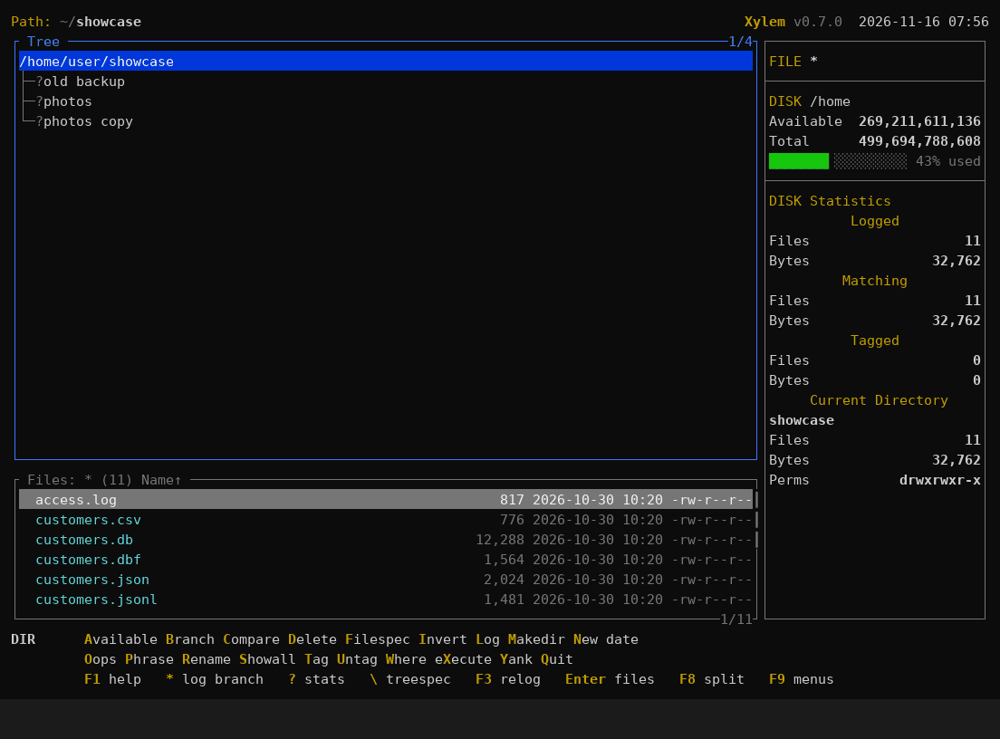

# Achar duplicados e ficar com uma cópia

Este procedimento localiza arquivos com conteúdo idêntico abaixo de um
diretório e envia para a lixeira todas as cópias exceto uma de cada.

## Passo a passo

1. Na árvore, posicione o cursor sobre o diretório e pressione `*` para ler seu
   ramo.
2. Pressione Alt+D. O Xylem compara os arquivos e lista os grupos de arquivos
   iguais, ordenando primeiro os grupos que liberam maior espaço.
3. Pressione `A`. Em cada grupo, todas as cópias exceto uma são marcadas (`T`).
4. Pressione `D`. O Xylem solicita confirmação antes de excluir. Pressione `T`
   para enviar os arquivos para a lixeira e, em seguida, `Y`.

O rodapé exibe `Trashed 4 of 4 files`.

## Escolher qual cópia manter

A tecla `A` marca todas as cópias exceto uma em cada grupo. Antes do passo 4,
é possível alterar qual delas deve ser preservada:

| Tecla | Efeito |
|---|---|
| `A` novamente | altera o critério da cópia preservada em cada grupo: a mais antiga, a mais nova ou a de caminho mais curto |
| `K` | preserva a cópia sob o cursor e marca as demais do grupo |
| `F` | em cada grupo que tenha uma cópia na pasta desta cópia sob o cursor, preserva essa cópia |
| `T` ou Espaço | marca ou desmarca uma cópia individual |
| `U` | desmarca tudo |

O Xylem não permite marcar a última cópia restante de um grupo.

## Pastas inteiras

A tecla `G` alterna a exibição para pastas cujos conteúdos sejam totalmente
idênticos. A linha ao final da lista indica quando existirem grupos desse tipo:
`1 group of folders (G)`.

## O que a pergunta significa

Com `delete_to_trash` desativado (o padrão), o passo 4 pergunta inicialmente
`DELETE 4 tagged files? This cannot be undone.`. A tecla `T` altera a pergunta
para `MOVE 4 tagged files to trash?`. Pressionar `Y` em seguida confirma a ação
descrita na mensagem.

## Quando não se comporta como esperado

- **Um arquivo reconhecidamente repetido não foi listado.** Arquivos menores que
  1 KiB, arquivos vazios, links simbólicos e as pastas `.git` e `node_modules`
  são ignorados por padrão. [Duplicados](duplicates.md) explica como alterar
  esse comportamento.
- **Um grupo não foi excluído.** Uma das cópias foi modificada após a
  comparação. Nenhum arquivo desse grupo é tocado e o rodapé relata o fato.
  Pressione F3 para refazer a comparação.

Veja também: [Duplicados](duplicates.md), [Excluir](delete.md),
[achar o que enche o disco](howto-disk-space.md).
