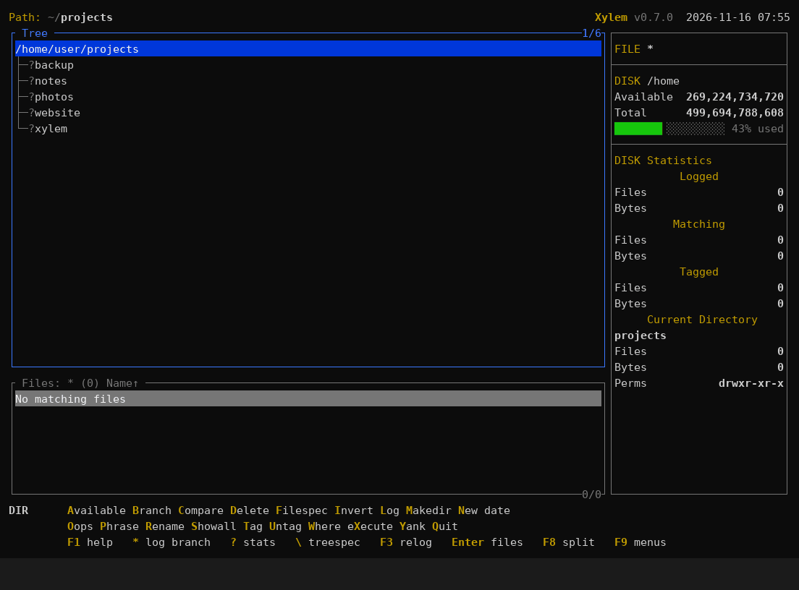

# Usar os arquivos marcados num comando do shell

Este procedimento executa `wc -c` sobre os arquivos marcados no Xylem a partir
do terminal integrado. Os mesmos passos funcionam com qualquer comando que
receba nomes de arquivos.

## Passo a passo

1. Na árvore, posicione o cursor sobre o diretório, pressione → para lê-lo e
   Enter para ir aos seus arquivos.
2. Marque os arquivos desejados: pressione `T` em cada um ou Ctrl+T para marcar
   toda a lista.
3. Pressione Alt+X. Um terminal abre na parte inferior da tela, com o shell
   posicionado no diretório exibido acima.
4. Digite o comando e um espaço, `wc -c `, e pressione Alt+O. O Xylem digita os
   nomes dos arquivos marcados na posição do cursor, cada um entre aspas.
5. Pressione Enter.



Pressionar Alt+X retorna ao Xylem. O shell permanece em execução, preservando
seu histórico, até que `exit` seja digitado.

## O que Alt+O digita

Os nomes são relativos ao diretório do shell e protegidos por aspas, de modo que
nomes contendo espaços são repassados como um único argumento cada:

```
wc -c 'ideas.md' 'todo.md'
```

Em um Branch ou Showall, os arquivos marcados pertencem a diferentes
diretórios; cada nome recebe seu caminho relativo a partir do diretório do shell.

## A variável

Ao abrir o terminal, o Xylem também define a variável `XY_TAGGED` com os
arquivos marcados.

| Shell | Como utilizar |
|---|---|
| bash | `cp "${XY_TAGGED[@]}" ~/backup` |
| zsh, fish | `cp $XY_TAGGED ~/backup` |
| sh, dash | não é definida |

A variável contém os arquivos marcados no instante em que o terminal foi aberto.
Se outros arquivos forem marcados no Xylem, a variável é atualizada na próxima
vez em que você entrar no terminal.

## Um único comando com eXecute

A tecla `X` (eXecute) solicita uma linha de comando avulsa e a executa. Nela,
`%t` representa os arquivos marcados e `%f` representa o arquivo sob o cursor:

```
tar czf photos.tar.gz %t
```

[eXecute](execute.md) descreve os demais marcadores suportados.

## Quando não se comporta como esperado

- **A primeira linha do terminal exibe ` . '…/sync.sh'`.** O Xylem a digita
  automaticamente para posicionar o shell no diretório da árvore e definir
  `XY_TAGGED`. O espaço inicial evita que o comando seja registrado no histórico
  do bash e do zsh.
- **Alt+O nada digita.** Não há arquivos marcados.
- **O shell não mudou de diretório.** Havia um programa em execução no
  terminal. O Xylem apenas envia o comando `cd` quando o shell está aguardando
  em seu prompt de comandos.
- **F1 não abre a ajuda.** No terminal integrado, todas as teclas são repassadas
  diretamente ao shell, com exceção de Alt+X, Alt+Z e Alt+O.

Veja também: [o terminal integrado](terminal.md), [eXecute](execute.md),
[Marcações](tagging.md).
