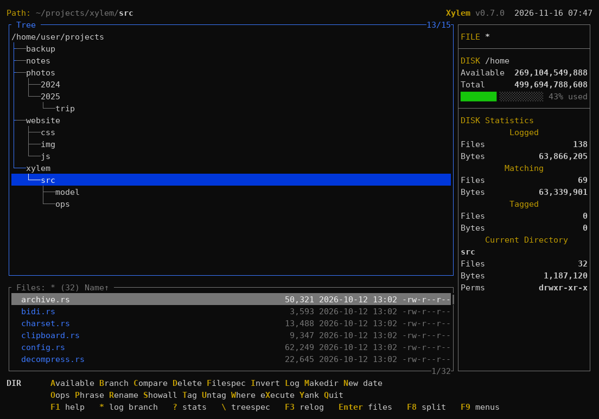

# A tela



```
 Path: ~/projetos/xylem/src            Xylem v0.7.0  2026-11-13 00:49   1
┌ Tree ──────────────────────────────────────┐ ┌──────────────────────┐
│ /home/user/projetos                        │ │ FILE *               │
│ ├──notes                                   │ │                      │
│ ├──photos                              2   │ │ DISK /home       4   │
│ └──xylem                                   │ │ Available   286,274… │
│    └──src                                  │ │                      │
└────────────────────────────────────────────┘ │ DISK Statistics      │
┌ Files: * (30) Name↑ ───────────────────────┐ │ Logged, Matching,    │
│ archive.rs      50,321 2026-10-12 13:02    │ │ Tagged               │
│ bidi.rs          3,593 2026-10-12 13:02  3 │ │ Current Directory    │
└────────────────────────────────────────────┘ └──────────────────────┘
 DIR   Available Branch Compare Delete Filespec …                       5
       F1 help   * log branch   ? stats   \ treespec …
```

| | Parte | O que mostra |
|---|---|---|
| 1 | Cabeçalho | Os selos de uma sessão root ou SSH (veja *Root e SSH* abaixo), o caminho do diretório sob o cursor, o nome e versão do programa, a data e hora. O nome e a versão são omitidos abaixo de 72 colunas. |
| 2 | Árvore | Os diretórios lidos. O número na borda superior indica a linha do cursor e a quantidade de linhas. |
| 3 | Janela de arquivos | Os arquivos do diretório sob o cursor da árvore. O título traz o Filespec, a quantidade de arquivos e a ordenação. |
| 4 | Estatísticas | O Filespec, o disco e as contagens de arquivos e bytes descritas abaixo. |
| 5 | Rodapé | O menu da janela que tem o foco. Um prompt ou mensagem ocupa sua primeira linha quando presente. |

A janela com o foco possui a borda brilhante.

## Root e SSH

Quando o Xylem roda com mais poder que o normal, ou em outra máquina, a tela
avisa:

- **`ROOT`** (**`ADMIN`** no Windows, executado como Administrador), em
  vermelho, na ponta esquerda do cabeçalho. Todas as bordas das janelas
  também ficam vermelhas, e a janela com o foco ganha borda grossa. As
  perguntas de Delete, Prune, Copy, Move, Rename, Attributes e New date
  começam com o mesmo selo quando podem alterar arquivos desta máquina; na
  máquina de uma janela remota quem age é o usuário da conexão, não o root, e
  o selo fica de fora.
- **`SSH máquina`**, depois dele: o Xylem roda dentro de uma sessão SSH, em
  `máquina`, não no computador à sua frente. Ele sabe disso pelas variáveis
  `SSH_CONNECTION`, `SSH_CLIENT` e `SSH_TTY` ou, no Linux, por um `sshd` ou
  `mosh-server` entre os processos que o iniciaram, o que funciona mesmo
  depois que `sudo` ou `su -` apagaram as variáveis.

Dentro do tmux ou do screen, as variáveis são as da sessão que iniciou o
servidor do tmux ou do screen. No macOS, sob `sudo`, a sessão SSH não é
detectada.

## A árvore

Cada linha é um diretório. O conector antes do nome indica o que se sabe
sobre ele:

| Conector | Significado |
|---|---|
| `├──` | lido, e aberto ou sem subdiretórios |
| `├─+` | lido, com subdiretórios que não estão visíveis |
| `├─?` | não lido: seus arquivos e subdiretórios não foram lidos |

Alt+K adiciona uma coluna com o tamanho, a quantidade de arquivos ou a
porcentagem de cada diretório. Veja [informações](info.md).

## A janela de arquivos: pequena e grande

Com o foco na árvore, a janela de arquivos é a pequena logo abaixo dela, e
acompanha o cursor da árvore. **Enter** dá a ela o foco e a altura total da
tela; a árvore fica oculta até pressionar Enter ou Esc.

`B` (Branch) e `S` (Showall) também abrem a janela de arquivos grande, com os
arquivos de mais de um diretório. O título começa então com `Branch:` ou
`Showall:`.

Alt+F altera o que cada linha exibe: nomes em colunas, nomes e tamanhos,
detalhes (tamanho, data e permissões), proprietário (*owner*), tipo ou nomes
longos. Veja [a janela de arquivos](files.md).

## As estatísticas

| Bloco | O que contabiliza |
|---|---|
| FILE | o Filespec em vigor; `*` exibe todos os arquivos |
| DISK | o sistema de arquivos do diretório atual: bytes livres e totais, e a fração em uso |
| Logged | os arquivos lidos para a memória nesta janela |
| Matching | os arquivos lidos que atendem ao Filespec |
| Tagged | os arquivos marcados, com uma barra para sua fração dos bytes correspondentes |
| Current Directory | os arquivos e bytes do diretório sob o cursor, e suas permissões |

`?` substitui a tela pelas estatísticas completas: a máquina, a rede e o
próprio Xylem. Veja [informações](info.md).

## O que altera a diagramação

| Tecla | Efeito |
|---|---|
| F8 | Duas janelas lado a lado, cada uma com sua árvore e janela de arquivos. Tab alterna entre elas. [Tela dividida](split.md) |
| F7 | Na janela de arquivos, a lista ocupa 40% da largura à esquerda e o conteúdo do arquivo sob o cursor o restante. [Autoview](files.md) |
| Alt+X | Um terminal ocupa a parte inferior da tela. Alt+Z dá a ele a tela inteira. [O terminal integrado](terminal.md) |
| Alt+U | A visualização de Uso substitui a árvore e a janela de arquivos. [Uso do disco](usage.md) |

Veja também: [os menus](menus.md), [a janela da árvore](tree.md).
