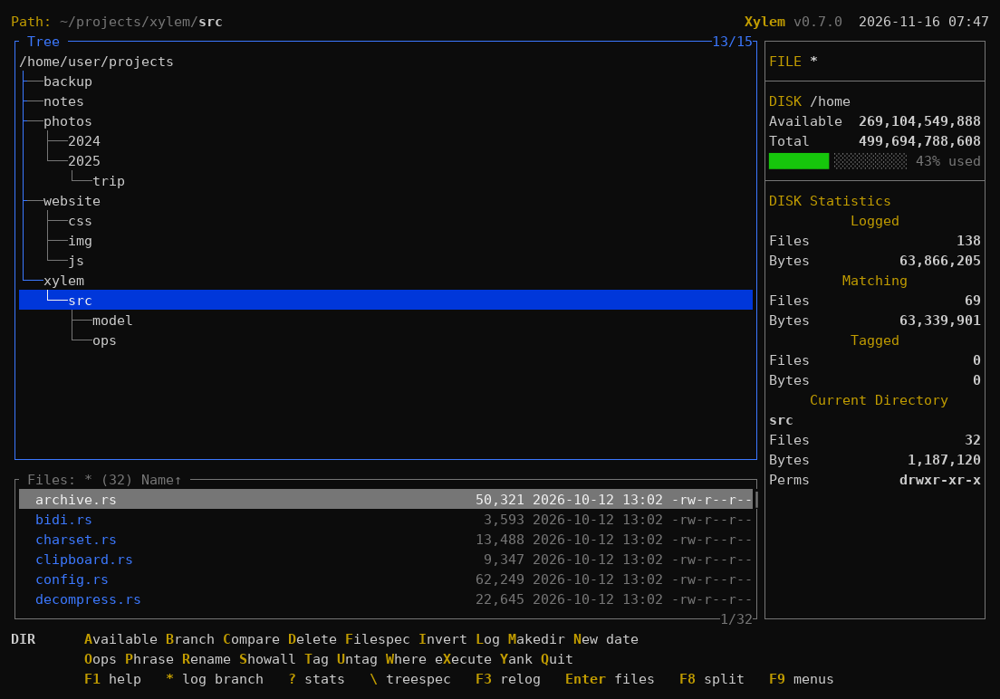

# The screen



```
 Path: ~/projects/xylem/src            Xylem v0.7.0  2026-11-13 00:49   1
┌ Tree ──────────────────────────────────────┐ ┌──────────────────────┐
│ /home/user/projects                        │ │ FILE *               │
│ ├──notes                                   │ │                      │
│ ├──photos                              2   │ │ DISK /home       4   │
│ └──xylem                                   │ │ Available   286,274… │
│    └──src                                  │ │                      │
└────────────────────────────────────────────┘ │ DISK Statistics      │
┌ Files: * (30) Name↑ ───────────────────────┐ │ Logged, Matching,    │
│ archive.rs      50,321 2026-10-12 13:02    │ │ Tagged               │
│ bidi.rs          3,593 2026-10-12 13:02  3 │ │ Current Directory    │
└────────────────────────────────────────────┘ └──────────────────────┘
 DIR   Available Branch Compare Delete Filespec …                       5
       F1 help   * log branch   ? stats   \ treespec …
```

| | Part | What it shows |
|---|---|---|
| 1 | Header | The badges of a root or SSH session (see *Root and SSH* below), the path of the directory under the cursor, the program's name and version, the date and time. The name and version are left out below 72 columns. |
| 2 | Tree | The logged directories. The number in the top border is the cursor's line and the number of lines. |
| 3 | File window | The files of the directory under the tree cursor. Its title has the Filespec, the number of files and the sort order. |
| 4 | Statistics | The Filespec, the disk, and the file and byte counts described below. |
| 5 | Footer | The menu for the window that has the focus. A prompt or a message takes its first line when there is one. |

The window with the focus has the bright border.

## Root and SSH

When Xylem runs with more power than usual, or on another machine, the
screen says so:

- **`ROOT`** (**`ADMIN`** on Windows, run as Administrator), in red, at the
  left end of the header. Every window border turns red too, and the window
  with the focus gets a thick border. The questions of Delete, Prune, Copy,
  Move, Rename, Attributes and New date start with the same badge when they
  may change files on this machine; on a remote window's machine the user of
  the connection acts, not root, and the badge is left out.
- **`SSH machine`**, after it: Xylem runs inside an SSH session, on
  `machine`, not on the computer in front of you. It knows from the
  `SSH_CONNECTION`, `SSH_CLIENT` and `SSH_TTY` variables or, on Linux, from an
  `sshd` or `mosh-server` among the processes that started it, which still
  works after `sudo` or `su -` cleared the variables.

Inside tmux or screen, the variables are those of the session that started
the tmux or screen server. On macOS, under `sudo`, the SSH session is not
detected.

## The tree

A line is a directory. The connector before the name says what is known
about it:

| Connector | Meaning |
|---|---|
| `├──` | logged, and open or without subdirectories |
| `├─+` | logged, with subdirectories that are not shown |
| `├─?` | not logged: its files and subdirectories have not been read |

Alt+K adds a column with the size, the number of files or the percentage of
each directory. See [information](info.md).

## The file window: small and large

With the focus on the tree, the file window is the small one under it, and it
follows the tree cursor. **Enter** gives it the focus and the height of the
screen; the tree is hidden until Enter or Esc.

`B` (Branch) and `S` (Showall) also open the large file window, with the
files of more than one directory. The title then starts with `Branch:` or
`Showall:`.

Alt+F changes what each line has: names in columns, names and sizes, details
(size, date and permissions), owner, type, or long names. See
[the file window](files.md).

## The statistics

| Block | What it counts |
|---|---|
| FILE | the Filespec in effect; `*` shows every file |
| DISK | the file system of the current directory: free and total bytes, and the share in use |
| Logged | the files read into memory in this window |
| Matching | the logged files that match the Filespec |
| Tagged | the tagged files, with a bar for their share of the matching bytes |
| Current Directory | the files and bytes of the directory under the cursor, and its permissions |

`?` replaces the screen with the full statistics: the machine, the network
and Xylem itself. See [information](info.md).

## What changes the layout

| Key | Effect |
|---|---|
| F8 | Two windows side by side, each with its tree and file window. Tab switches between them. [Split screen](split.md) |
| F7 | In the file window, the list takes the left 40% of the width and the contents of the file under the cursor the rest. [Autoview](files.md) |
| Alt+X | A terminal takes the lower part of the screen. Alt+Z gives it the whole screen. [The built-in terminal](terminal.md) |
| Alt+U | The Usage view replaces the tree and the file window. [Disk usage](usage.md) |

See also: [the menus](menus.md), [the tree window](tree.md).
