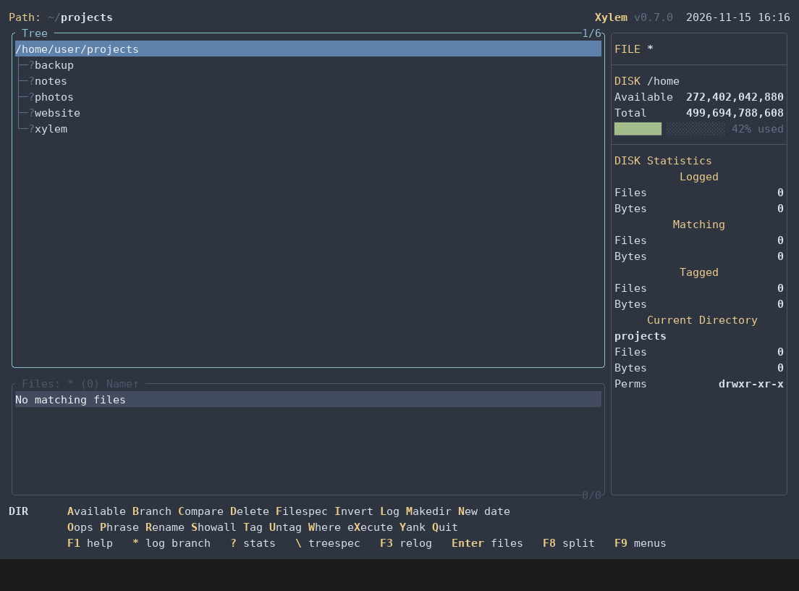

# 用计数器批量重命名文件

本指南演示如何将 `photos/2025/trip` 中的 9 张照片从 `DSC_01.jpg` … `DSC_09.jpg` 批量重命名为 `trip_001.jpg` … `trip_009.jpg`。

## 操作步骤

1. 在目录树中，将光标置于 `trip` 上并按 Enter 进入其文件列表。
2. 按 Ctrl+T。列表中的每个文件都被标记。
3. 按 Ctrl+R。提示行询问重命名掩码，默认内容为 `*.*`。
4. 按 Ctrl+U 清空提示行，输入 `trip_<001>.*` 并按 Enter。

底部状态栏显示 `Renamed 9 of 9 files`。文件按照列表当前的排列顺序进行编号，因此如果编号顺序很重要，请先进行排序（Alt+S）。

## 掩码的构成

| 组成部分 | 含义 |
|---|---|
| `trip_` | 复制到每个文件名中的固定文本 |
| `<001>` | 3 位数计数器：001、002、… |
| `.*` | 每个文件原有的扩展名，保持不变 |

步骤 4 中需要清空提示行，因为直接输入会追加在原有的 `*.*` 之后：`*.*trip_<001>.*` 会导致第一个文件被命名为 `DSC_01.DSC_01trip_001.jpg`。

## 其他掩码示例

| 掩码 | `DSC_01.jpg` 重命名为 |
|---|---|
| `*.jpeg` | `DSC_01.jpeg` |
| `2025_*.*` | `2025_DSC_01.jpg` |
| `s/DSC/trip/` | `trip_01.jpg` |
| `*.<upper>` | `DSC_01.JPG` |

[重命名](rename.md)列出了所有支持的掩码形式。

## 异常排查

- **没有任何文件被重命名。** 掩码会导致两个文件重名。如果不包含计数器且没有 `*` 通配符，所有文件都将被赋予同一个名称。
- **只有部分文件被重命名。** 只有已标记的文件才会被重命名。此前设置的 Filespec 可能会隐藏某些文件，而 Ctrl+T 仅标记当前列表中可见的文件。
- **Ctrl+R 仅重命名了单个文件。** 实际只按下了 `R` 键，单个字母 `R` 仅作用于光标下的单个文件。

另请参阅：[标记](tagging.md)、[Ctrl 菜单](commands-ctrl.md)。
