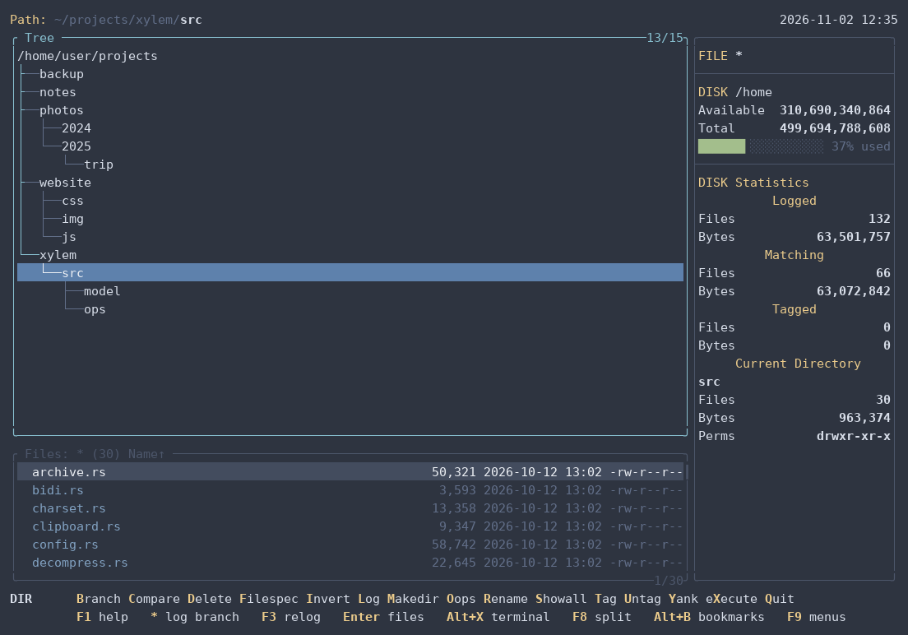

# 屏幕



```
 Path: ~/projects/xylem/src            Xylem v0.7.0  2026-11-13 00:49   1
┌ Tree ──────────────────────────────────────┐ ┌──────────────────────┐
│ /home/user/projects                        │ │ FILE *               │
│ ├──notes                                   │ │                      │
│ ├──photos                              2   │ │ DISK /home       4   │
│ └──xylem                                   │ │ Available   286,274… │
│    └──src                                  │ │                      │
└────────────────────────────────────────────┘ │ DISK Statistics      │
┌ Files: * (30) Name↑ ───────────────────────┐ │ Logged, Matching,    │
│ archive.rs      50,321 2026-10-12 13:02    │ │ Tagged               │
│ bidi.rs          3,593 2026-10-12 13:02  3 │ │ Current Directory    │
└────────────────────────────────────────────┘ └──────────────────────┘
 DIR   Available Branch Compare Delete Filespec …                       5
       F1 help   * log branch   ? stats   \ treespec …
```

| | 区域 | 说明 |
|---|---|---|
| 1 | 顶部标题行 | 光标所在目录的路径、程序名称与版本、日期与时间。在低于 72 列的终端中省略名称与版本。 |
| 2 | 目录树 | 已载入的目录。顶部边框中的数字为光标所在行号与总行数。 |
| 3 | 文件窗口 | 目录树光标所在目录中的文件。标题包含 Filespec、文件数和排序方式。 |
| 4 | 统计信息 | Filespec、所在磁盘，以及下文介绍的文件与字节计数。 |
| 5 | 底部状态栏 | 当前获得焦点的窗口的菜单。有输入提示框或通知消息时会占据首行。 |

当前获得焦点的窗口边框高亮显示。

## 目录树

每一行代表一个目录。名称前面的连接线符号说明了其载入状态：

| 符号 | 含义 |
|---|---|
| `├──` | 已载入，且已展开或无子目录 |
| `├─+` | 已载入，含有未展开的子目录 |
| `├─?` | 未载入：其中的文件与子目录尚未被读取 |

按 Alt+K 可添加一列，显示各目录的大小、文件数或百分比。参见[信息](info.md)。

## 文件窗口：半屏与全屏

当焦点在目录树上时，文件窗口是下方较小的面板，并跟随目录树光标移动。按 **Enter** 获得焦点并占据屏幕高度；目录树被隐藏，直到按 Enter 或 Esc 返回。

`B` (Branch) 与 `S` (Showall) 也会打开全高文件窗口，其中包含来自多个目录的文件。此时标题以 `Branch:` 或 `Showall:` 开头。

按 Alt+F 可更改每行显示的内容：分栏名称、名称与大小、详细信息（大小、日期与权限）、所有者、类型或长文件名。参见[文件窗口](files.md)。

## 统计信息

| 区块 | 统计内容 |
|---|---|
| FILE | 当前生效的 Filespec；`*` 显示所有文件 |
| DISK | 当前目录所在的文件系统：可用与总字节数，以及已用比例 |
| Logged | 当前窗口中已载入内存的文件总数 |
| Matching | 符合 Filespec 过滤条件的已载入文件数 |
| Tagged | 已标记的文件数，附带其占匹配字节比例的进度条 |
| Current Directory | 光标所在目录的文件数、字节大小及权限 |

按 `?` 可将屏幕替换为完整的统计信息：机器状态、网络情况与 Xylem 本身。参见[信息](info.md)。

## 改变布局的操作

| 按键 | 效果 |
|---|---|
| F8 | 并排显示两个窗口，各自拥有独立的目录树与文件窗口。按 Tab 在两者之间切换。[分屏](split.md) |
| F7 | 在文件窗口中，列表占据左侧 40% 宽度，光标所在文件的内容占据其余宽度。[Autoview](files.md) |
| Alt+X | 终端占据屏幕下半部分。按 Alt+Z 让终端全屏显示。[内置终端](terminal.md) |
| Alt+U | 磁盘用量视图替换目录树与文件窗口。[磁盘用量](usage.md) |

另请参阅：[菜单](menus.md)、[目录树窗口](tree.md)。
